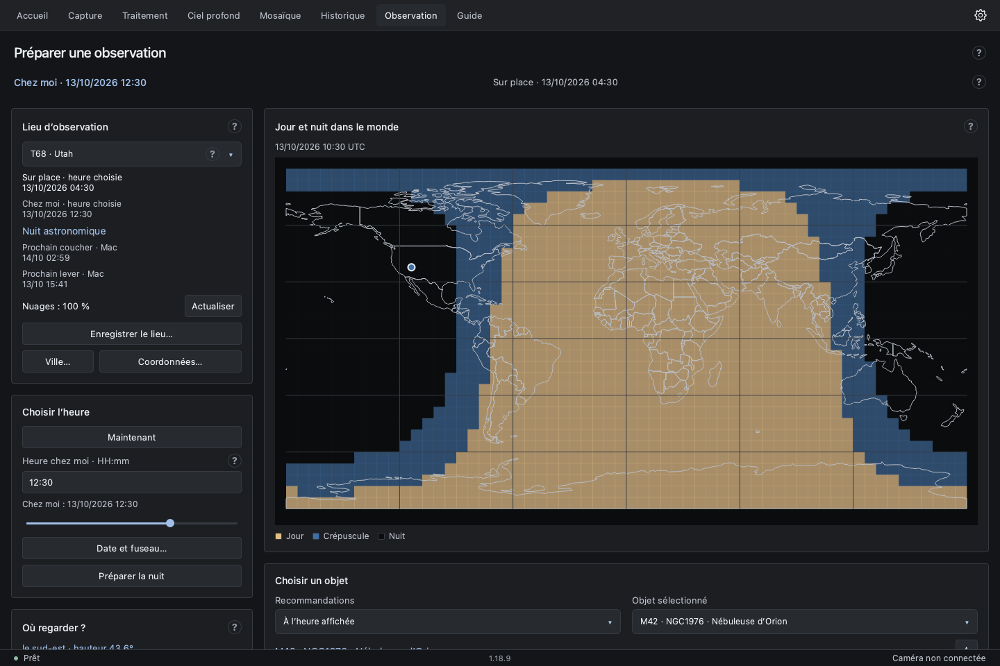
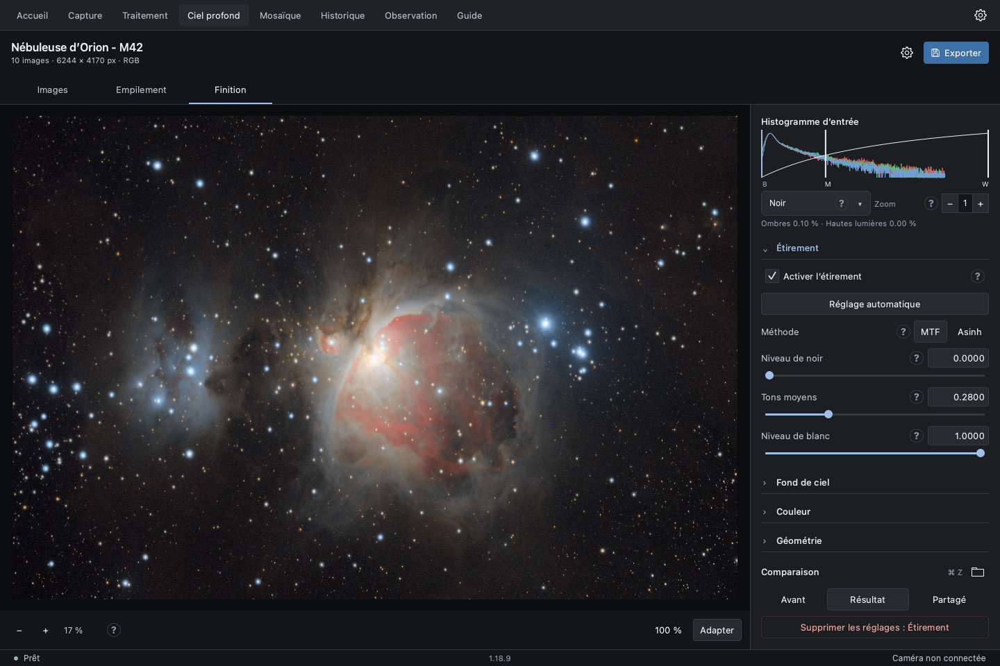
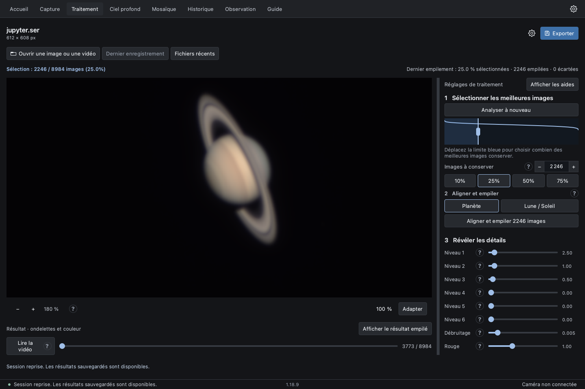
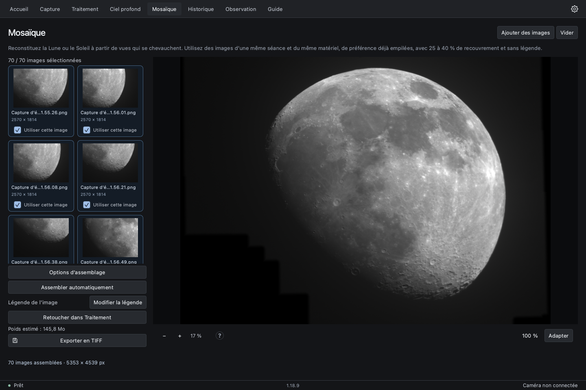

  

# AstroCapture

**Préparez vos observations, photographiez le ciel et traitez vos images sur Mac.**

AstroCapture rassemble les outils pour travailler sur la Lune, les planètes, les
nébuleuses et les galaxies : enregistrer des prises de vue, combiner les meilleures
images, ajuster le résultat et l’exporter.

Vous pouvez aussi partir de vidéos ou de photos déjà prises avec votre matériel
ou un télescope distant. Le traitement fonctionne sans caméra connectée.
L’application est disponible en français et en anglais.

[Installation](#installer-sur-mac) · [Premiers pas](#premiers-pas) · [Sauvegarde et export](#garder-son-travail-et-partager-une-image) · [Documentation](#aide-et-documentation)

## Installer sur Mac

Le paquet actuel est prévu pour les **Mac Apple Silicon**, équipés d’une puce de
la famille M.

1. Ouvrez le fichier `AstroCapture-<version>.dmg`.
2. Glissez **AstroCapture** dans le dossier **Applications**.
3. Lancez l’application depuis ce dossier.

Pour une mise à jour, quittez AstroCapture, puis remplacez l’application de la
même façon. Vos préférences, préréglages et historique sont conservés.

Le paquet n’est pas encore certifié par Apple : macOS peut demander une
autorisation d’ouverture.

## Premiers pas

L’**Accueil** permet de retrouver vos projets et vidéos récents. Choisissez
ensuite la page qui correspond à ce que vous voulez faire :

| Vous voulez… | Ouvrez… |
| --- | --- |
| Trouver un objet à observer et le bon moment | **Observation** |
| Enregistrer les images d’une caméra | **Capture** |
| Traiter une vidéo de la Lune ou d’une planète | **Traitement** |
| Combiner des photos d’une nébuleuse ou d’une galaxie | **Ciel profond** |
| Retoucher directement une image PNG ou TIFF | **Traitement** |
| Assembler plusieurs vues de la Lune ou du Soleil | **Mosaïque** |
| Retrouver vos images exportées | **Historique** |

### Préparer une observation

Dans **Observation**, choisissez votre lieu, une date et un objet. Le premier
lancement utilise Paris ; vous pouvez sélectionner une ville, saisir des
coordonnées ou cliquer sur la carte. Enregistrez vos lieux et objets habituels
en favoris pour les retrouver rapidement.

La page vous montre :

- où il fait jour ou nuit, ainsi que les horaires du Soleil ;
- les objets proposés à l’heure choisie ou pendant la nuit ;
- la direction où regarder et la hauteur de l’objet dans le ciel ;
- les prévisions de couverture nuageuse pour ce lieu.

Les cartes et graphiques suivent la même heure. **Sur place** indique l’heure au
lieu d’observation ; **Chez moi** indique à quelle heure cet instant correspond
sur votre Mac. C’est utile pour préparer une prise de vue depuis un télescope
situé dans un autre pays. **Quand lancer l’enregistrement ?** propose un créneau,
affiché à l’heure de votre Mac pour votre lancement manuel.

Les nuages sont une prévision météo. La visibilité calculée ne tient pas compte
d’un arbre, d’un bâtiment ou du relief devant votre télescope.

### Traiter une nébuleuse ou une galaxie

Dans **Ciel profond**, le parcours suit trois étapes : **Images → Empilement →
Finition**. Empiler consiste à combiner plusieurs photos du même objet pour
atténuer le bruit, ce grain qui masque les détails faibles.

1. **Ajoutez vos photos.** Vérifiez leur type dans la liste. Si vous utilisez des
   poses brutes, ajoutez aussi vos images de calibration : darks, flats et bias
   selon votre acquisition. Elles servent à corriger les défauts du capteur et
   les différences d’éclairage. Si vos poses sont déjà corrigées, cochez
   **Poses déjà calibrées**.
2. **Créez l’image empilée.** AstroCapture aligne les étoiles et combine les
   prises sélectionnées. Le bilan indique combien de poses ont été conservées.
3. **Ajustez le résultat dans Finition.** Révélez les détails avec l’étirement,
   puis réglez le fond de ciel, les couleurs et le bruit. Comparez le résultat
   avant et après vos réglages.
4. **Sauvegardez le projet et exportez votre image.** Vous pourrez reprendre
   les réglages plus tard et ajouter une légende à l’export.

Une image astronomique peut paraître très sombre avant l’étirement : c’est
normal. L’étirement rend les détails faibles visibles.

Les formats acceptés comprennent **FITS, RAW à matrice Bayer, PNG et TIFF**.
Les outils avancés, comme la composition de plusieurs filtres, les masques et
les réglages séparés des étoiles et du fond, restent disponibles dans Finition.

### Traiter la Lune ou une planète

Dans **Traitement**, ouvrez votre vidéo **SER**, un format courant en
astrophotographie planétaire.

1. Cliquez sur **Analyser la vidéo** pour classer les images par netteté.
2. Choisissez les images à conserver, puis **Aligner et empiler**.
3. Renforcez progressivement les détails, ajustez les couleurs et comparez
   l’avant et l’après.
4. Exportez le résultat en PNG, TIFF ou JPEG.

### Assembler une mosaïque

Pour assembler plusieurs portions de la Lune, traitez d’abord chaque vidéo,
puis ouvrez les images obtenues dans **Mosaïque** et cliquez sur
**Assembler automatiquement**. Les vues doivent partager une zone commune
pour pouvoir être raccordées.

## Garder son travail et partager une image

Les fichiers d’origine restent intacts. Les réglages et les exports travaillent
sur le résultat du traitement.

| À conserver | À quoi cela sert |
| --- | --- |
| **Projet portable `.astroproject`** dans Ciel profond | Reprendre le traitement avec ses sources, résultats, réglages et légende réunis dans un fichier. Il peut être volumineux. |
| **PNG ou TIFF 16 bits** | Garder une image finale de bonne qualité pour la retoucher ou l’imprimer. |
| **JPEG** | Partager facilement une version plus légère. |
| **FITS linéaire** dans Ciel profond | Conserver l’empilement avant les réglages de finition, pour repartir de cette base. |

À l’export, vous pouvez ajouter un titre et une légende en **blanc ou en doré** :
nom de l’objet, matériel, date ou temps de pose.

La sauvegarde automatique permet de reprendre la dernière session depuis
l’Accueil. Enregistrez aussi un projet pour conserver un traitement de ciel
profond que vous souhaitez retrouver ou déplacer.

## Aide et documentation

L’onglet **Guide** explique les étapes dans l’application, même sans connexion.
Les aides **?** près des réglages décrivent leur effet et donnent des repères
pour commencer. Vous pouvez annuler un réglage avec **⌘ Z**.

Les images et les traitements restent sur votre ordinateur. Internet sert aux
prévisions météo et à certaines recherches de villes ou d’objets. Les cartes
jour/nuit, les calculs de visibilité, le catalogue inclus et les favoris
fonctionnent hors connexion ; les problèmes de connexion sont signalés.

La compatibilité d’une caméra dépend de son modèle et de son pilote. La
Celestron NexImage 5 est le matériel de référence testé sur Mac. Vous pouvez
essayer la capture avec la caméra simulée proposée dans l’application.

Pour approfondir :

- [Documentation interne détaillée](docs/README_INTERNE.md) : fonctions, formats,
  réglages avancés et limites techniques, conservés depuis l’ancien README.
- [Évolutions du logiciel](CHANGELOG.md).
- [Développement et contribution](CONTRIBUTING.md).
