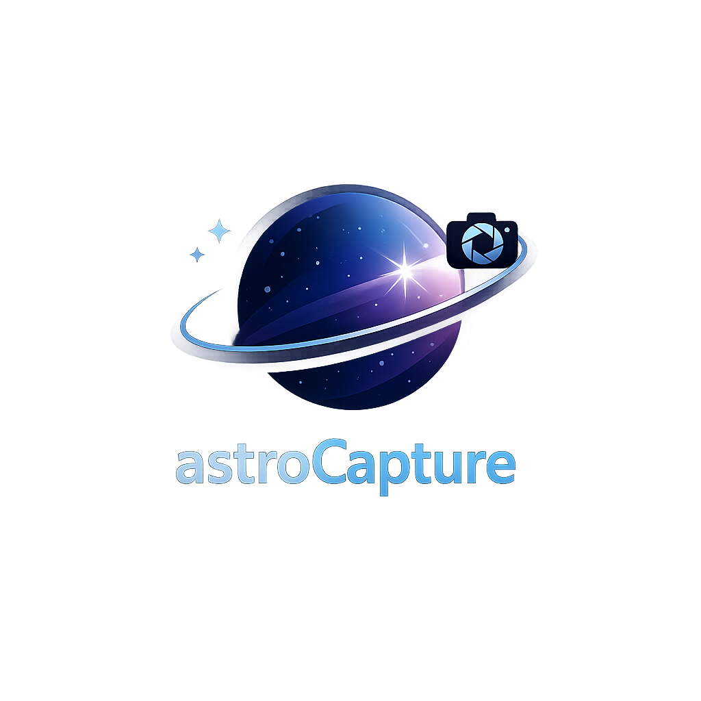
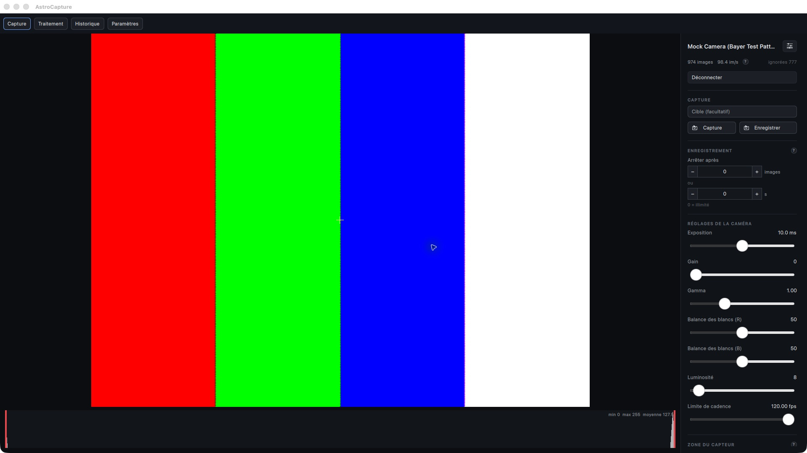
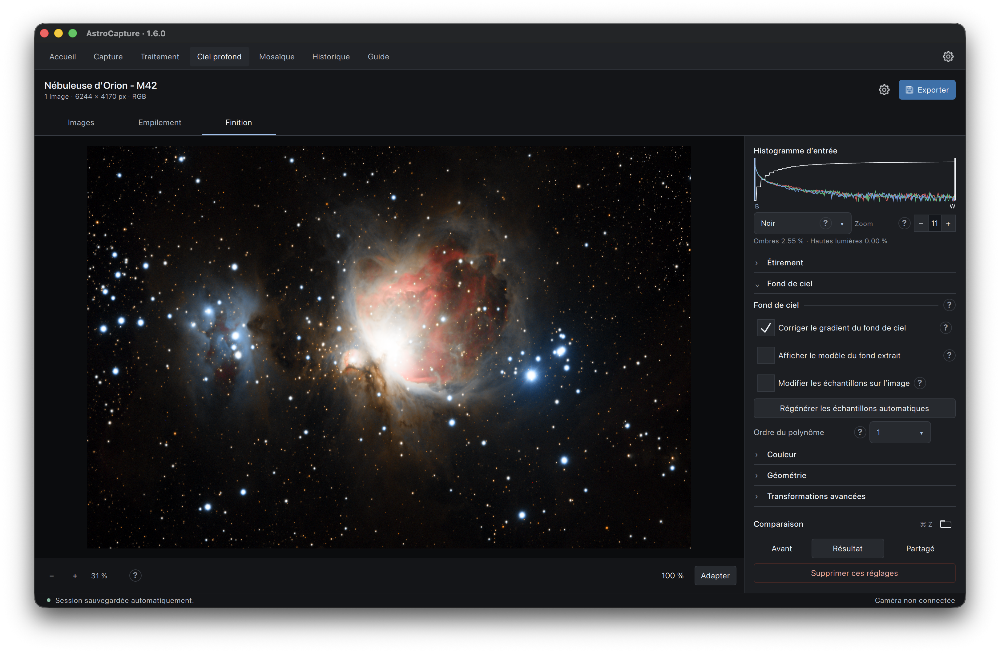
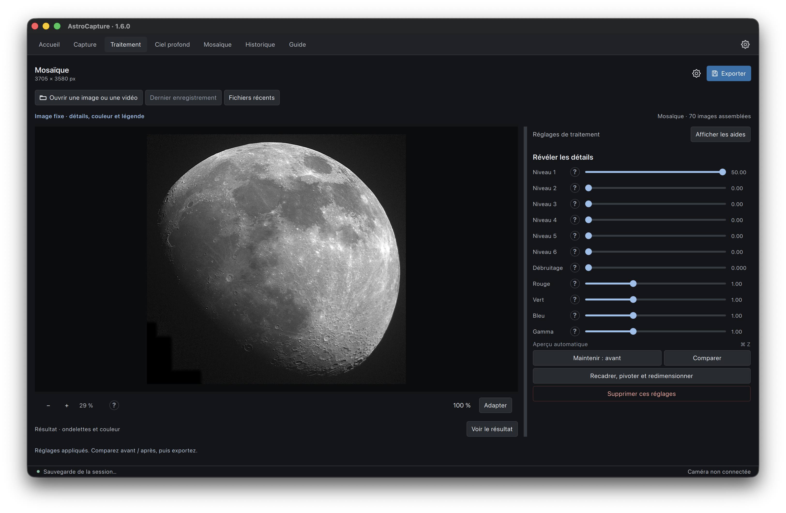
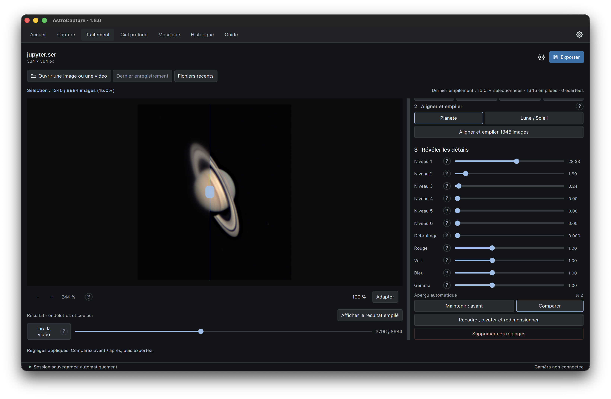
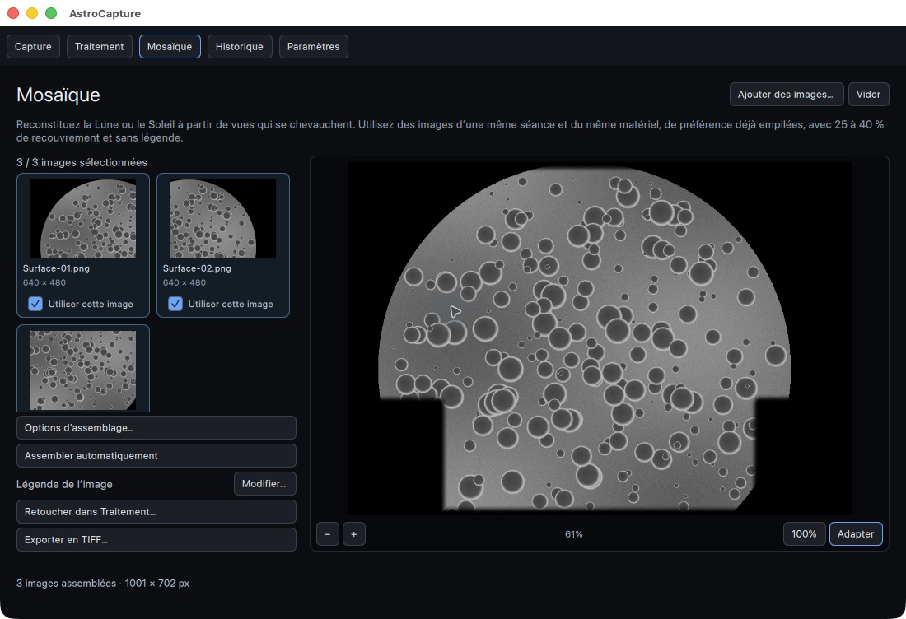
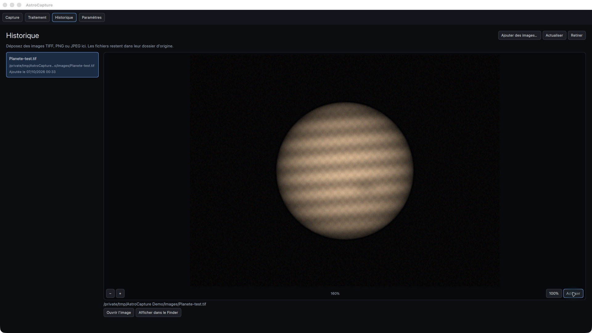
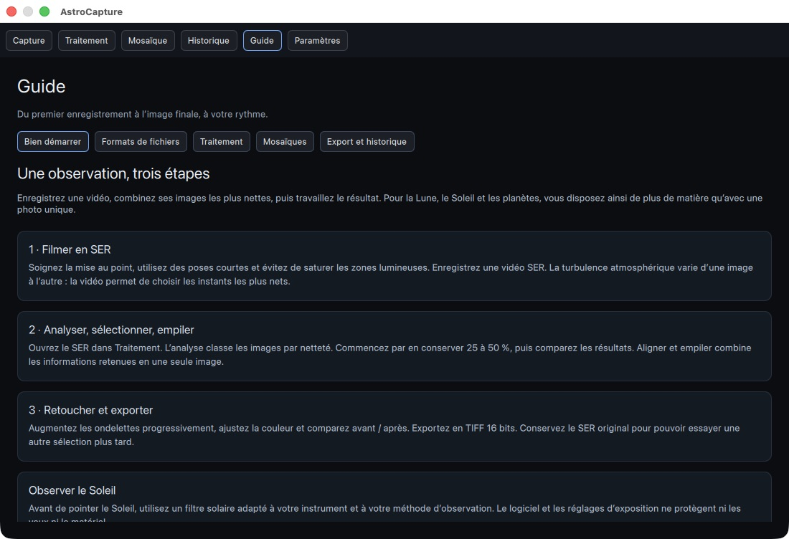
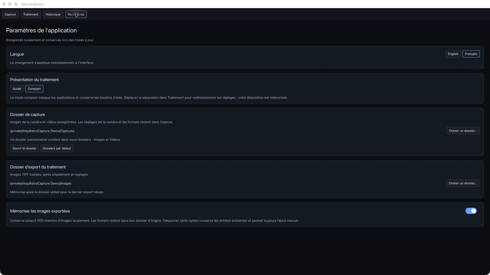

  

# AstroCapture

**De la caméra à l’image finale, dans une seule application sur Mac.**

AstroCapture réunit la capture vidéo et FITS, le traitement planétaire, la calibration et l’empilement du ciel profond, les transformations de finition, les ondelettes et les mosaïques. Son studio conserve les espaces de travail entre les onglets, avec une interface en français et en anglais. Les fichiers et les traitements restent sur votre ordinateur. Les aides au survol des réglages du ciel profond décrivent le calcul appliqué, son effet visuel et ses limites : seuils et écrêtage, courbes d’étirement, modèle polynomial du fond, rejet robuste, saturation et lissage.

[Capture](#capture) · [Ciel profond](#ciel-profond) · [Traitement](#traitement) · [Mosaïque](#mosaïque) · [Historique](#historique) · [Observation](#observation) · [Guide](#guide-intégré)

## Observation

L’onglet **Observation**, placé avant **Guide**, prépare une observation de la Lune,
des planètes ou d’un objet fixe. Il est indépendant de **Ciel profond**.

L’ouverture présente deux actions : **Trouver un objet visible** pour obtenir des
idées, ou **Étudier** la cible actuelle. Les courbes et les détails apparaissent
ensuite, selon la vue choisie.

1. **Objet sélectionné** indique la seule cible active. **Changer d’objet…** ouvre
   une liste unique avec recherche et favoris. Taper un nom filtre cette liste ;
   cliquer sur un résultat le sélectionne et ouvre sa courbe. Fermer la liste
   conserve le choix actuel.
2. Le premier lancement utilise le **centre de Paris** (48,8566° N, 2,3522° E).
   Ensuite, le dernier lieu choisi est repris, sans géolocalisation automatique.
   Choisissez un lieu proposé ou recherchez une ville en ligne. Ses coordonnées
   et son fuseau sont renseignés. **Nommer le lieu…** enregistre un libellé
   (Jardin, Balcon…), la position et le fuseau en favori, y compris pour un point choisi sur la carte. **Renommer…**
   modifie ce libellé en conservant les coordonnées ;
   les options avancées permettent d’en préciser les coordonnées.
3. Choisissez la date locale, ou **Nuit actuelle**. Une nuit terminée est refusée
   en préparation : la date valide est conservée et un message indique le problème.
   Avant le lever du Soleil, la nuit en cours peut porter la date d’hier. Le contrôle
   utilise le lever du Soleil et le fuseau du lieu ; sans lever, la limite est le midi
   suivant. **Options avancées → Consulter des dates passées** permet de revoir une
   observation, avec un repère explicite de consultation.

Les **Réglages de visibilité** se déplient à la demande. **30°** est une hauteur
minimale de départ ; le ciel très sombre est proposé pour le ciel profond,
le crépuscule pour la Lune et les planètes. Un seuil sans contrainte d’obscurité
permet aussi d’explorer le jour.

Enregistrez l’**objet sélectionné** avec l’étoile à côté de son nom. Retrouvez-le
ensuite dans **Changer d’objet… → Favoris**. Les lieux favoris apparaissent avec
une étoile dans la liste des lieux.
Les favoris restent sur cet ordinateur (100 objets et 30 lieux au maximum).

**Suggestions** compare les objets Messier inclus, quelques objets remarquables
notamment de l’hémisphère Sud, la Lune, les planètes et vos favoris. Le lieu, la date
locale et la hauteur minimale actualisent cette liste automatiquement. Jusqu’à
4 cibles du Système solaire et 6 du ciel profond sont proposées, avec priorité aux
favoris puis classement selon le temps au-dessus du seuil et la hauteur. Les filtres
**Tout**, **Lune et planètes** et **Ciel profond** permettent de parcourir ces familles. Chaque résultat
a au moins 20 minutes de créneau. Ses critères sont accessibles dans son aide : Soleil sous
−18° pour les objets fixes, sous −6° pour le Système solaire. **Explorer** sélectionne
la cible avec ces critères et ouvre sa courbe. Quatre suggestions sont affichées au départ ; un bouton ouvre les suivantes. La sélection n’est pas exhaustive ;
le catalogue complet reste interrogeable. Les suggestions de Mercure et Vénus
excluent les créneaux à moins de 30° du Soleil. Le matériel, la pollution lumineuse,
la Lune et la météo peuvent rendre un objet difficile à observer. Les prévisions
nuageuses chargées ajoutent leurs valeurs horaires disponibles dans chaque créneau,
sans modifier le classement géométrique.

**Nuages** affiche les prévisions horaires [Open-Meteo](https://open-meteo.com/en/docs)
de couverture totale, basse, moyenne et haute. **Charger** transmet les coordonnées
du lieu ; le curseur indique la prévision horaire la plus proche (à 30 minutes au
maximum), avec son heure locale et UTC. 0 % signifie aucun nuage prévu dans la
maille du modèle, 100 % une couverture complète. Les couches peuvent se superposer
et ne s’additionnent pas. Ces données sont des **prévisions de modèles**, pas une
mesure en direct, une probabilité de ciel dégagé ou un indice de turbulence.

La source, l’heure de récupération, les couches nuageuses et les coordonnées de la
maille du modèle sont accessibles dans **Détails de la prévision et source**. La période doit être couverte par l’horizon disponible (au maximum
16 jours à venir, avec les données de la veille). Les données manquantes, nulles ou
hors période sont explicites ; elles ne valent jamais 0 %. Aucun pourcentage n’est
extrapolé hors des heures retournées. **Actualiser** renouvelle la prévision.
Une fois chargée, une modification de lieu/date réutilise les données récentes ou
charge le nouveau lieu après un bref délai. Le curseur ne déclenche aucune requête.

La dernière prévision valide est conservée localement, y compris après réouverture,
et marquée comme **ancienne après une heure**. Un échec n’efface pas cette prévision ;
les données d’un autre lieu ne sont pas affichées sur le lieu courant. Le service
sans clé est prévu ici pour l’usage personnel non commercial. Les données sont sous
[CC BY 4.0](https://creativecommons.org/licenses/by/4.0/), avec attribution à Open-Meteo
et valeurs affichées arrondies ; le cache ne contient ni nom d’objet ni identifiant personnel.

Le **lever et le coucher du Soleil** sont visibles dans **Nuit**
et **Ciel**. La section **Détails** conserve les informations lunaires, la direction,
le jour, le crépuscule civil et la nuit astronomique.
Un libellé indique aussi l’état à l’instant du curseur, avec les crépuscules civil,
nautique et astronomique. Les périodes sans lever, coucher ou nuit sont explicites.

**Heure de référence**, dans les réglages, permet de choisir **Chez moi** (le fuseau
de ce Mac, par défaut) ou **Au télescope** (le fuseau configuré pour le lieu). Les deux
heures sont affichées quand les fuseaux diffèrent, avec la date et le décalage UTC.
Choisissez le jour dans ce fuseau et saisissez **HH:mm** : le curseur et les quatre
vues se placent au même instant. La conversion ne change ni le lieu ni la nuit.
Les axes des courbes, les horaires du Soleil et l’heure de la prévision restent
à l’heure du télescope ; leur fuseau est indiqué quand il diffère de chez vous.
Un point de carte utilise initialement UTC comme fuseau du télescope : précisez-le
dans les options avancées ou choisissez une ville. Une heure inexistante au passage
à l’heure d’été est refusée ; une heure répétée propose les deux décalages UTC.
Le choix du repère Mac/télescope est conservé après réouverture.

**Changer de position conserve l’instant UTC**, commun à tous les lieux. Les heures
locales sont converties et la date de la nuit s’ajuste pour contenir cet instant au
nouveau lieu. Par exemple, le 12 décembre à 18 h UTC correspond à 19 h à Paris et
à 5 h le 13 décembre à Sydney. Choisir une autre nuit, saisir une heure ou déplacer
le curseur modifie volontairement l’instant.

Dans **Nuit**, **Quand lancer l’enregistrement ?** indique le premier créneau
restant après l’heure réelle actuelle dans le fuseau de référence, avec sa fin et
sa durée. **Voir le début** place le curseur au début proposé. Pour rester dans les
seuils choisis, le début est arrondi à la minute suivante et la fin à la précédente.
**Tous les créneaux** conserve les limites précises à la seconde et les deux repères
horaires. Une nuit passée ou sans créneau restant est explicite. Ce repère prépare
un lancement manuel ; il ne déclenche pas l’acquisition et ne garantit pas la météo
ou l’absence d’obstacles.

**Nuit**, **Ciel**, **Monde** et **Nuages** suivent le même curseur horaire, avec
actualisation pendant le glissement et valeur finale appliquée au relâchement.
**Ciel** indique où regarder avec une vue boussole : nord en haut, est à droite,
horizon théorique au bord (0°) et zénith au centre (90°). Le point indique l’objet
à l’heure choisie ; la ligne montre son parcours sur la nuit. La direction
cardinale et la hauteur sont affichées. Ce schéma ne montre ni le relief ni les
obstacles de votre horizon réel. Les créneaux bleus
respectent les seuils de hauteur et d’obscurité. Les heures locales et UTC sont
affichées avec la date ; la période va de midi au midi suivant et peut durer 23 ou
25 heures lors d’un changement d’heure. Le module indique aussi le lever/coucher
du centre, le point le plus haut dans cette période, la fraction éclairée de la Lune
et sa distance angulaire à la cible.

**Monde** montre où l’**objet sélectionné** respecte les seuils de hauteur et
d’obscurité à l’instant UTC affiché. Sa courte légende distingue les seuils respectés,
l’objet trop bas, le ciel trop clair et l’objet sous l’horizon. Elle ne représente
ni les nuages ni simplement le jour et la nuit. Cette vue conserve seulement la carte,
la légende et le curseur ; les horaires et détails du lieu restent dans Nuit/Ciel.
La carte est une vue régionale sur une grille de **6°**, calculée au même instant UTC.
Un clic choisit un lieu et conserve cet instant, avec le fuseau initial **UTC** :
choisissez le fuseau local dans les options avancées si nécessaire.

Le catalogue [OpenNGC](https://github.com/mattiaverga/OpenNGC) est inclus sans connexion.
Les autres noms d’objets fixes sont recherchés par [CDS Sesame](https://cds.unistra.fr/doc/sesame.htx),
en envoyant uniquement le nom. La recherche de ville envoie seulement le texte saisi
à [Open-Meteo / GeoNames](https://open-meteo.com/en/docs/geocoding-api).
Un message indique l’absence ou la perte de connexion lorsque le système la
signale, ainsi qu’un échec ou un délai dépassé des recherches en ligne. Un échec
ne remplace pas les résultats précédents. Le rétablissement de la connexion
permet de réessayer ; les recherches de noms ne sont pas relancées automatiquement. Les calculs,
les suggestions, le catalogue et les favoris ne nécessitent pas Internet.

Les éphémérides de la Lune et des planètes sont calculées localement avec
[Astronomy Engine](https://github.com/cosinekitty/astronomy).

Les calculs de position des cibles utilisent un horizon géométrique plat et le
centre des astres, sans réfraction ni masque des obstacles. Le lever/coucher du
Soleil utilise son bord supérieur, avec une réfraction atmosphérique standard de
34 minutes d’arc au niveau de la mer, adaptée à l’altitude du lieu. L’observateur
est supposé au sol ; le relief et l’abaissement de l’horizon ne sont pas modélisés.
Les seuils de crépuscule (−6°, −12°, −18°) utilisent le centre géométrique du Soleil.
Le temps réel peut varier avec les conditions atmosphériques et les obstacles. Les coordonnées fixes J2000 incluent précession
et nutation, mais pas le mouvement propre ni l’aberration annuelle. Ce module vise
la préparation à la minute d’arc, sans garantir une précision de pointage. Les créneaux
sont recherchés par pas d’une minute et leurs limites affinées à la seconde ; de très
brèves fenêtres tangentes peuvent échapper au pas de recherche. **La turbulence,
les réservations et le pilotage d’acquisition ne sont pas inclus.** Les nuages sont
prévus séparément ; les calculs de visibilité ne garantissent pas les conditions réelles.

## Installer sur macOS

Ouvrez `AstroCapture-<version>.dmg`, glissez **AstroCapture** dans **Applications**, puis lancez l’application. Pour une mise à jour, quittez d’abord AstroCapture et remplacez l’application existante. Les préférences, les préréglages et l’historique sont conservés séparément de l’application.

Le paquet actuel est destiné aux Mac Apple Silicon. Il n’est pas encore signé avec un certificat Apple Developer ID ni notarisé : macOS peut demander une autorisation d’ouverture.

Aucune caméra n’est nécessaire pour traiter un SER existant. Une caméra simulée permet également d’essayer l’acquisition.

## Capture

L’onglet **Capture** affiche le flux de la caméra et les commandes disponibles pour le matériel connecté : exposition, gain, résolution et zone de capture lorsqu’elle est prise en charge. L’aperçu couleur interprète la matrice de Bayer des capteurs compatibles.

L’histogramme permet de surveiller l’exposition. La cadence, les compteurs d’images et les pertes signalées aident à contrôler la capture. Les images fixes peuvent être enregistrées en PNG, TIFF 16 bits ou FITS brut ; le format SER est recommandé pour les vidéos destinées à l’empilement.

La **Celestron NexImage 5** est le matériel de référence : capteur MT9P031, 2 592 × 1 944 pixels de 2,2 µm. La réception des images a été vérifiée sur Mac. Le profil Bayer GBRG actuellement utilisé reste à confirmer avec une cible de couleur connue. Les possibilités de réglage dépendent du pilote et de la caméra ; la compatibilité de chaque autre modèle doit être vérifiée individuellement.

## Accélération Apple Silicon

Depuis la version 1.0.1, AstroCapture utilise automatiquement **Metal** pour les réglages de ciel
profond à partir de 1 MP et pour les ondelettes actives à partir de 0,26 MP.
L’étirement classique ou asinh, les gains couleur, la saturation, le lissage et
les six échelles d’ondelettes conservent des pixels **RGB flottants 32 bits**.
L’aperçu 8 bits est calculé dans la même commande GPU, puis affiché à sa
résolution complète. Une conversion d’aperçu seule reste sur CPU : les mesures
montrent que sa copie vers le GPU coûterait plus que son calcul.

Sur un **M1 Pro**, avec le résultat Siril M8/M20 de **6244 × 4172** pixels,
les mesures incluent les allocations et copies des traitements ; elles ne sont
pas une promesse sur le temps total d’importation ou d’empilement. Les résultats
et la méthode de mesure sont consignés dans les notes locales `docs/`.

Les calculs GPU travaillent par bandes avec recouvrement pour préserver les
bords et raccords tout en limitant la mémoire temporaire. L’annulation attend
la fin du bloc GPU en cours avant de libérer ses données. Le CPU prend le relais
si Metal est absent, désactivé, manque de mémoire ou rencontre une erreur.
Les petites images gardent le CPU. La calibration, la détection et l’alignement
d’étoiles, l’empilement et les exports conservent leurs méthodes actuelles.

Pour compiler sans cette accélération : `-DASTRO_ENABLE_METAL=OFF`. Pour un
contrôle ponctuel sur Mac : lancez l’application avec `ASTRO_DISABLE_METAL=1`.
Les autres systèmes utilisent le moteur CPU, sans dépendance Metal.

## Ciel profond

L’onglet **Ciel profond** propose un parcours inspiré de l’organisation
d’Astro Pixel Processor, avec les principes de calibration et de traitement
linéaire décrits dans le [tutoriel de Siril](https://siril.org/fr/tutorials/tuto-scripts/) : charger, calibrer, analyser les étoiles, aligner,
normaliser, empiler puis finir l’image. Réglez les étapes puis lancez toute la
chaîne avec **Créer l’image empilée**. Les onglets **Images**, **Empilement** et **Finition** organisent les réglages.
Dans Finition, l’histogramme accompagne l’image et les familles **Étirement**,
**Fond de ciel**, **Couleur**, **Géométrie** et **Transformations avancées** se
déplient indépendamment : vous pouvez en ouvrir plusieurs ou toutes les refermer.
La comparaison reste accessible en bas du panneau ; supprimer les réglages agit
sur la famille indiquée et reste annulable avec **⌘ Z**. Le rouage du projet
rassemble la sauvegarde et les préréglages de toute la finition. Le mode brut est sélectionné par défaut ;
cochez **Poses déjà calibrées** uniquement pour des données déjà prétraitées.

- Utilisez **Ajouter des fichiers** ou **Importer un dossier**. Le mode de
  détection automatique classe les images selon leurs métadonnées et noms ;
  vérifiez et corrigez les types et groupes directement dans la liste. Les
  fichiers de résultat nommés resultat, stack, rvb ou hoo sont écartés de
  l’importation automatique d’un dossier.
- Importez les **FITS individuels** d’iTelescope, y compris les FITS compressés,
  ou des **RAW à matrice Bayer**. Les PNG/TIFF sont aussi acceptés. Pour des
  FITS déjà calibrés, cochez **Poses déjà calibrées**.
- Le groupe **Auto** lit le filtre de l’en-tête FITS ; choisissez R, G, B, L,
  HA, OIII ou SII si nécessaire. Les filtres sont empilés séparément.
- Pour les poses brutes, ajoutez darks, flats, bias et éventuellement darks de
  flats. Un dark brut contient déjà le bias : il n’est pas soustrait deux fois.
  Les darks doivent correspondre à la durée d’exposition et aux paramètres
  connus du capteur. Les flats sont associés à leur groupe de filtres.
- La correction des pixels défectueux utilise une carte importée ou détecte
  les pixels chauds isolés du master dark. Elle respecte la matrice de Bayer
  avant dématriçage.
- Inspectez le nombre d’étoiles, la FWHM en pixels et les aperçus ; décochez les
  poses à exclure. **Référence** choisit la référence d’un groupe.
- L’alignement sur les étoiles corrige déplacements, rotations et petits
  écarts d’échelle. Au moins six étoiles identifiables sont nécessaires pour
  recaler une autre pose. La normalisation globale harmonise le flux des
  étoiles et les offsets du fond de ciel ; elle peut être désactivée.
- L’intégration utilise une moyenne avec ou sans rejet robuste par médiane/MAD.
  Le rejet nécessite trois poses retenues ou plus. Le résultat est recadré sur
  la couverture commune. Le bilan indique les poses exclues et les valeurs
  rejetées ; les images alignées utilisent de l’espace disque temporaire.
- Dans **Finition → Couleur**, choisissez **RGB, LRGB, SHO ou HOO** : les couches
  empilées sont attribuées automatiquement. Les filtres manquants bloquent la
  composition et sont indiqués ; **Personnalisée** conserve le choix manuel.
  L’**apport de luminance** va de 0 % (luminosité RGB) à 100 % (L recalée),
  sans égalisation implicite des unités d’exposition. Cliquez sur **Composer
  l’image** après modification ; l’indication distingue le résultat affiché des
  nouveaux choix. Ceux-ci sont sauvegardés dans le projet et la reprise.
  Résolvez de nouveau le WCS de l’image composée. Réglez ensuite le fond de
  ciel, les gains couleur, les niveaux noir/blanc, les tons moyens ou l’étirement
  asinh (maximum, luminance visuelle ou moyenne RGB), la saturation avec protection du fond sombre et le lissage
  du bruit. L’histogramme RGB/luminance représente l’image affichée. Un second
  histogramme montre l’entrée des réglages, après la recette et la correction
  de gradient, avec les gains couleur courants et
  la courbe d’étirement : choisissez Noir, Tons moyens ou Blanc et glissez
  dans le graphique. Le zoom du graphique ne modifie pas les données. Les
  taux de coupure sont estimés par échantillonnage.
- Les aperçus de sources distinguent matrice **Bayer**, image **RGB** et image
  **monochrome**. **Aperçu couleur** et **Étirement d’affichage automatique**
  sont indépendants des données utilisées pour la calibration.
- L’extraction du gradient ajuste chaque couche séparément : polynôme d’ordre
  1 à 4, grille de 2 à 50 échantillons par ligne (20 par défaut), tolérance de
  rejet en unités MAD (1 par défaut). Les échantillons se modifient sur l’image :
  clic gauche pour ajouter, clic droit pour retirer. Le modèle du fond peut
  être affiché séparément pour contrôler la correction. Les modèles insuffisamment
  contraints sont refusés. Une correction d’ordre 1 peut aussi s’appliquer à
  chaque pose calibrée et dématricée avant alignement ; elle reste facultative.
- La finition propose rotations de 90°, 180°, 270° et miroirs horizontal/vertical.
  Les exports finaux les utilisent ; le FITS linéaire garde l’intégration source.
- La suppression du vert (SCNR) offre quatre protections et la préservation CIE
  de luminosité. Elle agit sur des valeurs RGB étirées dans [0, 1]. Les méthodes
  par masque proposent un dosage ; les méthodes neutres n’utilisent pas ce dosage.
  Préservez les couleurs vertes intentionnelles des comètes, nébuleuses ou palettes SHO.
- Les réglages s’appliquent automatiquement après chaque modification. Les demandes
  successives sont regroupées pour conserver la dernière position des curseurs.
  Choisissez une pose dans la comparaison et maintenez **Pose brute** pour afficher
  cette source face au résultat courant. Son cadrage et son étirement sont indépendants.
  Les projets et les préréglages conservent tous les réglages de finition.
- **Exporter** propose **FITS linéaire 32 bits** pour préserver l’intégration originale,
  ou **Export classique** pour choisir PNG 16 bits, TIFF 16 bits ou JPEG et ajouter
  une légende facultative dans l’éditeur commun. PNG et TIFF préservent les détails
  sans compression destructive. La légende est sauvegardée dans le projet.
- Le **rouage** regroupe ouvrir, enregistrer et vider le projet. Les
  paramètres avancés se déplient et les aides au survol expliquent les réglages.
- Les projets **.astroproject** proposent deux modes. **Portable** rassemble les
  sources, calibrations, masques importés, empilements par filtre, résultats
  flottants, réglages, légende et versions A/B dans un seul fichier, avec une
  estimation de taille. **Lié** conserve les chemins et réglages dans un petit
  fichier ; l’intégration est à recalculer. Les anciens projets restent lisibles.
- **Retrouver les sources déplacées** recherche dans le dossier choisi et ses
  sous-dossiers et vérifie l’empreinte SHA-256 du contenu. Les anciens projets
  sans empreinte peuvent utiliser une comparaison explicite des métadonnées ;
  les correspondances ambiguës et les anciens masques restent à traiter manuellement.
- **Paramètres → Stockage et reprise** affiche le poids des caches et de la session.
  Le nettoyage protège le travail ouvert et les caches utilisés par la reprise.
  Une sauvegarde portable vérifie aussi les sources modifiées depuis l’import.
  Les archives sont limitées à 128 Gio, dont 4 Gio de résultats et aperçus ;
  la sauvegarde utilise de l’espace temporaire et l’ouverture crée un cache local.

Les données originales restent linéaires et ne sont jamais écrasées. Le premier
aperçu et la première finition utilisent un étirement adaptatif et des gains
couleur estimés sur le fond de ciel, sans calibration photométrique ; les exports
linéaires ne l’appliquent pas. La recette est rejouée depuis l’intégration
linéaire ; les transformations validées s’accumulent dans leur ordre sauvegardé.

**Échelle des données :** les FITS entiers sont normalisés selon leur plage.
Pour les FITS flottants sans indication spécifique, des valeurs supérieures à
2 sont interprétées comme des ADU sur une échelle de 65535 ; sinon l’échelle est
1. Le champ **Échelle ADU** permet d’imposer une autre convention à l’import.
Utilisez une échelle cohérente entre poses et calibrations. La correction
automatique du gradient est un ajustement planaire : comparez avec l’option
désactivée sur des nébulosités étendues.

**Drizzle mono/RVB et Bayer natif** — dans **Empilement → Réglages avancés** :

- Projection directe des pixels calibrés par recouvrement de carrés, avant toute
  interpolation d’alignement, avec échelle **×1, ×1,5 ou ×2** et fraction de pixel
  **0,5 à 1** (départ conseillé : **0,8**). En mode mono/RVB, les sources Bayer sont dématricées.
- Pertinent pour des poses sous-échantillonnées et décalées à des phases
  sous-pixel variées ; augmenter la taille ne garantit pas de nouveaux détails.
  Il faut au moins deux poses utilisables par filtre ; beaucoup de poses avec
  dithering améliorent la couverture et permettent un rejet plus fiable.
- Moyenne pondérée par surface couverte et rejet robuste sur les contributions
  disponibles. Les valeurs nulles, négatives et supérieures à 1 restent valides.
  Les zones sans données bloquent l’opération ; les bordures géométriques sont
  recadrées. Le bilan indique les nombres minimal/moyen de poses contributrices.
- Dimensions avant recadrage affichées et limite de **128 MP** vérifiée avant de
  lancer. ×2 multiplie les pixels par quatre : une pose de 26 MP ne peut donc
  pas être agrandie ×2 dans cette version. ×1 reste disponible.
- Intensité linéaire conservée dans la convention des sources ; le flux intégré
  dépend de la surface des pixels sur le ciel ; aucune calibration photométrique
  de surface n’est appliquée. WCS TAN/SIP et
  échantillonnage suivent l’échelle et le recadrage. Réglages sauvegardés dans
  les projets et sessions ; FITS linéaire conserve le résultat drizzle Float32.

- **Projection des distorsions WCS / SIP**, depuis **1.13.0**, en option pour
  les poses FITS déjà résolues : projection de toutes les poses, référence
  comprise, sur une grille TAN sans SIP, en empilement classique et drizzle
  (y compris Bayer natif). Chaque pose exige au moins **12 étoiles** dans quatre
  régions, couvrant **35 %** de chaque dimension, avec **RMS ≤ 0,75 px**.
  Une solution absente ou incohérente écarte la pose ; aucun remplacement
  silencieux par un alignement affine. Au moins deux poses validées par filtre
  doivent rester. Le bilan, les options et les coordonnées de sortie sont
  sauvegardés. Ces contrôles vérifient l’alignement relatif ; l’astrométrie
  absolue reste à résoudre avec un catalogue avant PCC/SPCC. Les valeurs
  suivent la convention d’intensité des sources : cette option n’applique pas
  de calibration de flux absolu ni de correction photométrique de surface des pixels.

- **Bayer natif / CFA**, depuis **1.11.0**, reconstruit les trois canaux à partir
  des échantillons calibrés réellement mesurés, sans dématriçage des pixels
  projetés. RGGB, BGGR, GRBG et GBRG sont pris en charge. Une copie couleur
  sert à estimer l’alignement et le modèle facultatif de gradient ; seuls les
  échantillons de leur couleur d’origine passent à la projection.
- Commencez en Bayer natif à **×1**, **fraction de pixel 1**, avec beaucoup de
  poses et un dithering varié. La couverture et le rejet sont vérifiés par canal
  couleur ; des poses identiques ne suffisent pas à reconstruire toutes les
  couleurs. Un canal sans données bloque le calcul et conserve l’ancien résultat.
- Gardez **Matrice Bayer des métadonnées** par défaut. Certains FITS indiquent
  seulement `BAYERPAT=VALID` : choisissez explicitement la matrice vérifiée de
  l’image enregistrée, en tenant compte du recadrage, des décalages et de l’ordre
  des lignes. La déclaration complète uniquement les matrices manquantes des
  poses et calibrations sélectionnées à un canal ; une matrice connue contradictoire
  bloque l’empilement. Les fichiers originaux restent intacts. Les fichiers RVB
  déjà dématricés ne conviennent pas au mode natif.
- Le bilan indique la matrice retenue et les contributions par canal couleur,
  avant rejet. Le mode et la déclaration sont conservés dans les projets et
  sessions. Le stockage temporaire Bayer utilise **24 octets par pixel de sortie
  et par pose**, contre 16 en mono/RVB, hors images et buffers en mémoire.

Le [guide technique du drizzle mono/RVB](docs/decisions/ADR-021-drizzle.md) et
son [extension Bayer native](docs/decisions/ADR-022-bayer-drizzle.md) précisent les
unités, la couverture et les limites de ces modes.

**Cartes de diagnostic** — dans **Empilement → Réglages avancés**, activez
**Conserver les cartes de poids et de rejet** avant le calcul. Inspectez et
exportez en FITS Float32 les poids géométriques conservés, le nombre de
contributeurs après rejet et les rejets bas/hauts réunis, séparément en R/V/B.
Le WCS est celui de l'empilement. L'aperçu réduit est normalisé pour l'affichage ;
l'export conserve les valeurs exactes. Ces cartes ne mesurent pas le bruit ni
la qualité. Elles ajoutent environ **36 octets par pixel de sortie et par groupe**
à la mémoire et aux projets ; elles sont facultatives et désactivées par défaut.

**Fusion HDR linéaire** — dans **Empilement → Fusionner les expositions · HDR**,
sélectionnez **2 à 8 FITS linéaires déjà calibrés**, du même filtre et avec la
même caméra, le même gain/offset/binning et les mêmes unités. Préparez un
empilement moyen par durée, sans étirement ; vérifiez les **durées individuelles**,
car `EXPTIME` peut désigner le temps cumulé d'un empilement. Le seuil de
saturation est propre à chaque entrée : **1 n'est pas une valeur universelle**.
L'alignement stellaire et le fondu emploient un poids commun aux trois canaux.
Les incompatibilités connues et les alignements dont le résidu dépasse 1 pixel
bloquent la fusion. Le résultat reste linéaire, exprimé comme la pose
individuelle la plus longue. Les pixels saturés dans toutes les poses disponibles
restent signalés ; leur détail n'est pas inventé. Deux cartes binaires et le bilan
sont conservés dans le projet. Le temps total d'intégration n'est pas déduit.
Les limites et unités sont détaillées dans
[la note technique](docs/decisions/ADR-023-integration-diagnostics-hdr.md).

Limites actuelles : **128 MP par image**, **500 poses sélectionnées par groupe**,
**2000 fichiers par projet**. Les RAW X-Trans et les autres matrices non Bayer
ne sont pas pris en charge. La correction optique dynamique, les
projections grand angle et les profils fabricant prévalidés
caméra/filtres restent à développer.
Le WCS guidé et les calibrations PCC/SPCC sont décrits ci-dessous. La précision de centroidage annoncée par APP
n’est pas une mesure de performance d’AstroCapture.

Depuis **1.14.0**, Empilement affiche la mémoire estimée, le budget de sécurité et
l’espace temporaire nécessaire/libre avant le calcul. **Dossier temporaire** permet
de choisir un disque local plus grand. Les buffers flottants de rejet sont bornés
à **64 Mio**, avec une archive de travail par calcul et contrôle d’espace pendant
l’écriture. Les demandes dépassant le budget mémoire ou les limites prévues de
reprise sont refusées avec une explication. La mémoire affichée est un modèle
conservateur, pas une mesure exacte du processus ; la sortie reste limitée à
**128 MP et 32 700 pixels par dimension**, selon les budgets mémoire et de reprise. Depuis **1.16.0**, la projection drizzle utilise aussi des bandes de **64 Mio** ; FITS et TIFF sont encodés par blocs. Les résultats Float32 restent complets en mémoire : les combinaisons de finition trop coûteuses sont refusées avant calcul. Un capteur de 26 MP en drizzle ×2 produit environ **104 MP**. Les cartes, couches et groupes supplémentaires peuvent dépasser le budget ; la reprise reste limitée à **4 Gio / 64 images**. Voir les [unités et limites](docs/decisions/ADR-027-large-images.md).

### Transformations avancées du ciel profond

La fenêtre **Transformations avancées** conserve l’image visible et regroupe
cinq outils. Les paramètres entrent dans l’historique, les
préréglages et les projets existants ; les anciens projets gardent des valeurs
neutres pour les nouveaux outils. Les diagnostics décrivent le dernier résultat
appliqué, pas les paramètres encore en attente.

- **GHS** : implémentation indépendante des [équations publiées par Payne et
  Cranfield](https://www.ghsastro.co.uk/doc/tools/GeneralizedHyperbolicStretch/GeneralizedHyperbolicStretch.html).
  Force `ln(D+1)` de 0 à 20 (0 par défaut), intensité locale `b` de −5 à 15,
  `0 ≤ LP ≤ SP ≤ HP ≤ 1`, courbe directe/inverse et deux modes : RVB
  indépendant ou luminance pondérée avec protection par mélange RVB.
  La courbe d’aperçu utilise le même calcul en double précision que le moteur.
  L’inverse scalaire ne restaure pas les pertes dues aux seuils, aux masques
  ou au mélange couleur. Le GHS remplace tons moyens/asinh quand il est actif.
- **PSF et Richardson–Lucy** : PSF circulaire gaussienne ou Moffat, FWHM
  0,5–12 pixels et β Moffat 1,5–10. Noyau fini centré, symétrique, normalisé
  à somme 1 ; l’aperçu du noyau utilise une racine carrée d’affichage.
  La mesure des étoiles centrales estime une FWHM gaussienne par moments,
  avec au moins trois étoiles non saturées parmi 1 500 candidates au maximum ; elle n’est pas un ajustement
  Moffat ni une estimation aveugle. Vérifiez-la avant d’utiliser l’estimation.
  Richardson–Lucy agit sur la luminance pondérée puis multiplie les canaux
  par un facteur commun. Réglages initiaux : 10 itérations, amortissement
  du résidu 0,001, mélange 1 et arrêt relatif 0,0001. L’amortissement n’est
  pas une régularisation TV. Le calcul indique les itérations réellement
  effectuées. Les bords utilisent une réflexion ; la PSF est constante sur
  tout le champ. Les valeurs non finies ou négatives sont refusées. Un
  piédestal **explicite**, sauvegardé et conservé dans le résultat, est disponible.
- **Réduction du bruit multiéchelle** : B3-spline à trous, 1–5 échelles,
  seuillage doux selon la MAD de chaque échelle, dosage indépendant des
  détails de luminance et de chrominance. Valeurs initiales : 3 échelles,
  seuil 3 σ robustes, intensités 0,5. Le résidu grossier reste inchangé.
  L’estimation du bruit avant/après repose sur les différences entre pixels
  voisins ; elle ne mesure pas la qualité scientifique de l’image. Ce
  moteur ne prétend pas reproduire NL-Bayes, DA3D ou un débruitage neuronal.
- **Masques** : plage de luminance, région circulaire ou étoiles détectées
  (150 au maximum), contour progressif et inversion. La visualisation du
  masque est indépendante de l’export. Blanc = traitement complet,
  noir = entrée intacte, gris = mélange pondéré. Le masque est calculé sur
  l’entrée de chaque opération, appliqué une fois après traitement, puis
  l’orientation transforme l’ensemble. La portée se choisit : toute la finition, débruitage multiéchelle,
  déconvolution, ou étirement et couleur. Les masques **peints** permettent
  de protéger ou révéler une zone au pinceau avec rayon en pixels, dureté,
  opacité et annulation des traits. Les masques **importés** acceptent
  FITS, PNG et TIFF aux dimensions exactes de l’entrée, avec valeurs entre
  0 et 1. Les images couleur sont converties en luminance pondérée.
  Le flou du bord est un sigma gaussien en pixels ; zéro le désactive.
  Les fichiers importés restent des références externes : conservez-les
  avec le projet. Le masque agit après le traitement choisi, pas pendant
  chaque itération de déconvolution.
- **Couleurs photométriques par références locales** : CSV strict
  `x,y,red,green,blue`, avec au moins 3 étoiles déjà identifiées dans l’image,
  coordonnées en pixels depuis zéro en haut à gauche et flux de référence
  positifs (pas des magnitudes). Photométrie d’ouverture, soustraction du
  fond par médiane d’anneau, rejet des étoiles saturées/proches des bords et
  rejet robuste des rapports incohérents. Les médianes de rapports
  logarithmiques donnent les gains R et B relatifs au vert fixé à 1.
  Ouverture/anneau par défaut : 5/8/12 pixels, seuil de saturation 1 à adapter
  à l’import. Le bilan expose références acceptées/rejetées, gains et
  dispersion robuste en magnitudes. C’est une calibration **relative** sur
  RVB linéaire à bande large. Cet import manuel ne réalise pas de résolution
  astrométrique ni de calibration spectrale ; les nouvelles commandes
  **PCC / SPCC** ci-dessous utilisent le catalogue automatiquement. Les références sont
  spécifiques à une image, même lorsqu’un préréglage les conserve.

**Bibliothèque de masters** — dans le **rouage du projet → Bibliothèque de masters** :

- Créez un dark, bias, dark-flat ou flat depuis les sources sélectionnées d’un
  seul filtre et matériel ; ou importez un master FITS existant. La moyenne
  utilise un rejet médiane/MAD dès trois sources, avec fichiers temporaires
  pour limiter la mémoire. Les masters restent en Float32.
- Caméra, dimensions, Bayer, binning, gain, offset, température et durée
  servent à vérifier la compatibilité. Les informations manquantes demandent
  une revue explicite ; les incompatibilités bloquent l’application.
  Les dark-flats sont comparés aux flats sélectionnés.
- Pour créer un flat, sélectionnez aussi son bias ou dark-flat adapté. Un
  flat enregistré est déjà corrigé et normalisé : son niveau électronique
  n’est pas soustrait deux fois. Un master dark contient déjà le bias.
- Le bilan expose sources, médiane, bruit MAD et échantillons rejetés.
  L’empreinte SHA256 protège chaque FITS lors de son utilisation. Sélectionner
  un master désélectionne les autres fichiers de ce rôle. Retirer son entrée
  conserve le fichier pour les projets existants. Les projets portables
  emportent les masters utilisés avec leurs autres sources.

Depuis **1.15.0**, **Créer des masters par lots** prépare jusqu’à 64 groupes à la
fois, séparés par les métadonnées enregistrées de leur configuration. Vérifiez
le plan, les sources et les correctifs des flats ; les informations inconnues
et les correctifs ambigus demandent une décision explicite. Les groupes sont
calculés successivement, avec contrôle mémoire/disque et provenance SHA-256.
Une annulation ou la première erreur arrête le lot en conservant les masters
terminés et le résultat de l’image. La bibliothèque permet la recherche par
nom, caméra, filtre ou réglages, le filtrage par rôle et le masquage des
incompatibilités. Aucun master n’est appliqué automatiquement. Des poses de
configurations hétérogènes nécessitent encore des intégrations séparées.
Voir [le périmètre et les limites](docs/decisions/ADR-026-batch-calibration-masters.md).

**Étoiles et fond** — nouvelle famille dans **Finition** :

- Extraction native par ajustement d’une PSF circulaire gaussienne ou Moffat
  sur un fond local plan, après correction du gradient et calibration couleur.
  Les vues **Combiné**, **Étoiles** et **Fond** montrent les couches calculées.
- Luminosité et tons moyens des étoiles, saturation indépendante des deux
  couches, luminosité et débruitage du fond. La réduction stellaire diminue
  leur contribution lumineuse ; elle ne rétrécit pas leur rayon. Les réglages
  neutres reproduisent exactement la finition commune, même après étirement.
- FWHM, bêta Moffat, limite des candidates, tolérance de l’ajustement et seuil
  de saturation sont accessibles, avec aides. Le bilan affiche étoiles
  acceptées/rejetées, saturées et RMS normalisée. Les étoiles saturées,
  superposées et mal ajustées restent dans le fond. Les aigrettes, halos
  irréguliers et structures compactes imposent une inspection à 100 % : le
  fond est une **estimation PSF**, pas un retrait neuronal complet des étoiles.
- Les couches finies s’exportent séparément en FITS Float32 signé avec WCS/SIP
  et géométrie actuelle. Leur addition reproduit le résultat combiné à
  l’arrondi flottant près. L’export principal conserve l’image combinée ;
  **FITS linéaire** garde l’intégration d’origine. Réglages, A/B et couches
  calculées persistent dans les sessions et projets portables.

**Astrométrie WCS et couleurs sur catalogue** — dans **Finition → Couleur →
Astrométrie · PCC / SPCC** :

- Résolution **TAN/ICRS** guidée par le centre et l’échantillonnage. Gaia DR3 en ligne
  ou CSV local, prise en compte des mouvements propres, rotation et miroir.
  Contrôles par étoiles associées, RMS en pixels/secondes d’arc et couverture du
  champ ; repères sur l’image. La résolution ne modifie aucun pixel.
- **Résolution aveugle locale** : identifie le champ sans coordonnées ni échelle
  de départ avec Astrometry.net embarqué dans le DMG. Installez l’index grand
  champ 4109 depuis le dialogue (47,5 Mio), ou choisissez un dossier d’index
  adaptés à votre champ. L’image reste sur le Mac ; seule la vérification Gaia
  interroge le catalogue en ligne. Un CSV Gaia permet cette vérification hors ligne.
- **SIP d’ordre 2 à 5** : modèle les distorsions optiques. L’ordre 3 est proposé ;
  davantage de coefficients exige davantage d’étoiles de référence. Le modèle
  est vérifié sur le champ et conservé dans les projets, sessions et FITS,
  ainsi qu’après recadrage, rotation, miroirs et changement d’échelle.
- **Recherche par nom** : M42, NGC 7000 ou une autre désignation de catalogue
  via CDS Sesame. La position J2000 proposée renseigne le centre de recherche ;
  il faut ensuite résoudre et vérifier le champ. Le WCS existant reste intact.
- **PCC** : modèle de continuum fondé sur les températures Gaia, référence Bessell
  R/V/B ou réponse importée. L’extinction et les raies stellaires limitent ce modèle.
- **SPCC** : téléchargement des **spectres XP mesurés Gaia DR3** et intégration
  photonique avec la **réponse réelle de l’équipement** (QE × filtres RVB × filtre
  supplémentaire). Import CSV `wavelength_nm,red,green,blue`, valeurs de 0 à 1,
  longueurs croissantes entre 336 et 1 020 nm et extrémités nulles. La réponse de
  la caméra n’est pas devinée. Blanc Soleil CALSPEC ou Fν constant (AB).
- **Profils de matériel** : enregistrer et réutiliser les réponses RVB mesurées
  importées, avec caméra, filtres, source et notes. Sauvegarde de la bibliothèque
  en JSON ; chaque projet conserve sa propre copie de la courbe. Choisir un profil
  ne recalibre pas l’image : PCC/SPCC se lance séparément.
- Photométrie robuste avant étirement, au moins huit étoiles acceptées, bilan des
  rejets et gains. Références liées à l’image linéaire exacte, intégrées aux
  projets, préréglages et versions A/B ; annulation par Cmd+Z.
- WCS conservé en FITS flottant et transformé avec la géométrie de la finition.
- **Coordonnées au survol** du résultat : ascension droite ICRS en heures,
  déclinaison en degrés, copie en formats sexagésimal et décimal. Les positions
  suivent la géométrie, le zoom et la comparaison avant/après ; leur précision
  dépend du WCS vérifié.

- Catalogues, spectres et recherches de noms sont mis en cache. Les requêtes
  transmettent le nom ou les coordonnées, jamais l’image. Les profils fabricant
  prévalidés restent à développer.

Voir [le guide des formats et des limites](docs/decisions/ADR-016-astrometry-colors.md).
Le [parcours des cibles, profils et coordonnées](docs/decisions/ADR-017-astrometry-workflow.md)
précise leur utilisation et leur sauvegarde.

L’ordre des traitements est : gradient → piédestal → photométrie →
réduction du bruit multiéchelle → déconvolution → gains et étirement →
saturation et lissage → SCNR → mélange du masque → orientation → recadrage → rotation libre → redimensionnement. Les mesures photométriques
et la déconvolution sont bloquées après une transformation étirée ou orientée ;
la photométrie est globale et refuse un masque. Les fichiers d’entrée doivent
réellement être linéaires : le logiciel ne peut pas déduire un étirement externe
uniquement de l’extension FITS.

**Image finale** propose aussi le FITS 32 bits traité, qui conserve les valeurs
flottantes sans l’écrêtage des exports TIFF/JPEG. **FITS linéaire** conserve
l’intégration originale. Les nouveaux outils utilisent pour l’instant le CPU ;
les chemins Metal existants restent actifs pour les opérations prises en charge.
La validation couvre des fixtures analytiques et synthétiques, l’annulation,
la sauvegarde et un aperçu GHS/bruit/masque sur une brute réelle de 26 MP ;
elle ne constitue pas une comparaison de qualité exhaustive avec Siril.

### Acquisition de séries FITS

Dans Capture, choisissez **Ciel profond · Série FITS**, la durée de pose, le
nombre d’images, le type de calibration et le filtre. Chaque image conserve les
pixels du capteur avant dématriçage et les métadonnées disponibles. Les réglages
de la caméra sont verrouillés pendant l’enregistrement. Une image commencée
avant le lancement de la série est écartée au démarrage.

Les photos fixes FITS conservent également les pixels bruts ; les photos TIFF
sont dématricées avec leur précision réelle, sans passer par l’aperçu 8 bits.
Le suivi et l’autoguidage de la monture restent externes. Les poses longues
dépendent des capacités du pilote et doivent être validées sur le matériel réel.

## Traitement

Déposez un fichier **SER ou ACRAW** dans la fenêtre, ouvrez-le avec le sélecteur de fichiers ou retrouvez-le dans **Récents**. Les dix dernières vidéos ouvertes avec succès sont mémorisées.

Pour retoucher une image existante, utilisez **Ouvrir une image ou une vidéo** ou déposez un **PNG ou TIFF** dans l’onglet Traitement. Les ondelettes, la couleur, la comparaison avant / après et la légende sont disponibles directement, sans analyse ni empilement. Les images 8 et 16 bits sont acceptées, jusqu’à **128 MP**, avec conservation des valeurs 16 bits. Les fichiers multipages ne sont pas acceptés et la transparence est placée sur fond noir. Choisissez **PNG 16 bits** (par défaut) ou **TIFF 16 bits** dans la fenêtre **Exporter**. Les deux formats conservent les détails sans compression destructive et acceptent une légende. L’export crée une copie ; l’original est protégé contre l’écrasement.

### 1. Sélectionner les images

**Analyser la vidéo** attribue un score de netteté à chaque image et les classe de la plus nette à la plus floue. La courbe représente ce classement, et non l’ordre chronologique de la vidéo. Sa hauteur indique la netteté relative, avec la meilleure image à 100 % ; la zone colorée correspond à la sélection.

Choisissez un nombre d’images, un pourcentage, ou déplacez la limite bleue directement sur le graphique. La sélection part toujours des meilleures images. Une sélection de 25 à 50 % constitue un point de départ : conserver moins d’images privilégie les meilleures prises, tandis qu’en conserver davantage peut réduire le bruit. Le score reste une aide à la décision, sensible au bruit et aux conditions de prise de vue. Le nombre et le pourcentage retenus restent visibles au-dessus de l’aperçu.

### 2. Aligner et empiler

**Aligner et empiler** recale les images sélectionnées par translation, avec un affinement inférieur au pixel, puis en calcule la moyenne. Les alignements incertains sont écartés et l’image finale est recadrée sur la zone commune. Le bilan indique combien d’images ont effectivement été empilées.

Pour la **Lune et le Soleil**, choisissez le mode correspondant avant d’empiler. Après le recalage global, des zones de la surface sont suivies séparément pour atténuer les déformations dues à la turbulence. Les zones peu fiables conservent le recalage global. Commencez avec des zones de **96 pixels** ; essayez 64 pixels sur des détails fins et contrastés, ou 160 pixels sur une surface plus douce ou bruitée. L’option **Meilleures images par zone**, activée par défaut dans ce mode, choisit des prises différentes pour chaque portion de la surface. Une image dont seule une partie est nette peut ainsi contribuer utilement. La limite bleue fixe alors un maximum d’images **par zone**, et non une liste identique pour toute l’image. La courbe reste le classement global ; le bilan distingue la sélection par zone du nombre total de prises utilisées. Cette sélection parcourt toute la vidéo et prend davantage de temps. Désactivez-la pour conserver la sélection globale avec correction locale.

Filmez avec des poses courtes, une mise au point soignée et une exposition qui préserve les hautes lumières. La sélection rejette les prises les plus floues ; l’alignement local réduit les déplacements des détails ; la moyenne atténue le bruit. Aucun traitement ne peut restituer les détails absents de toutes les images. Pour le Soleil, utilisez impérativement un équipement de filtration solaire adapté à votre instrument.

Le résultat est une **image fixe**. **Lire la vidéo** et le curseur temporel affichent toujours les images du SER d’origine ; le bouton de résultat permet de revenir à l’empilement. Les opérations longues affichent leur progression et peuvent être annulées.

### 3. Révéler les détails

Les six niveaux d’ondelettes agissent sur des échelles de détail qui doublent progressivement de taille :

| Niveaux | Effet principal |
| --- | --- |
| 1–2 | Détails fins et petits contours ; ils renforcent aussi facilement le bruit. |
| 3–4 | Structures intermédiaires et transitions. |
| 5–6 | Grandes structures et variations de contraste ; des gains élevés peuvent créer des halos. |

Ces échelles se recouvrent : un niveau ne correspond pas à un objet astronomique précis. Les gains vont de **0 à 50 pour le niveau 1**, de **0 à 20 pour les niveaux 2 et 3**, et de **0 à 10 pour les niveaux 4 à 6**. Un gain nul n’ajoute aucun détail à cette échelle ; augmenter le gain renforce aussi le bruit et peut créer des halos. Les valeurs ne sont pas interchangeables avec celles d’autres logiciels. Le débruitage atténue les petites variations des détails ajoutés ; les gains rouge, vert et bleu et le gamma permettent d’ajuster la couleur et la luminosité.

L’aperçu se met à jour après une courte pause pendant les réglages. **⌘ Z / ⌘ ⇧ Z** permettent de parcourir jusqu’à 100 modifications des paramètres, chaque glissement comptant comme une modification. Les préréglages nommés enregistrent les ondelettes, le débruitage, les gains couleur et le gamma pour les réutiliser sur une autre vidéo.

Maintenez **Avant** pour revoir l’empilement sans les réglages de finition, ou activez **Comparer** : la séparation déplaçable montre l’avant à gauche et l’après à droite. Le zoom, le déplacement de l’image et la comparaison n’affectent pas le fichier exporté.

### 4. Exporter

Le bouton à disquette **Exporter** ouvre le choix du format : **PNG ou TIFF RGB 16 bits par canal**, sans perte, ou **JPEG 8 bits** pour le partage. PNG est le format proposé par défaut ; choisissez PNG ou TIFF pour conserver la précision issue de l’empilement et des réglages. Le SER d’origine reste inchangé. Le dossier utilisé pour le dernier export réussi est mémorisé.

Le **poids estimé** apparaît avant l’export et s’actualise selon le format et la légende. Le TIFF et le FITS linéaire utilisent un calcul de taille ; pour les grands PNG/JPEG, l’estimation repose sur des portions de l’image à pleine résolution. Le signe **≈** indique que le poids final peut varier avec la compression.

Une **légende facultative** peut être inscrite dans l’image exportée : objet, date d’observation, notes en haut à gauche ; observateur et matériel en bas à gauche. Un champ **Titre** place un titre plus grand juste au-dessus du texte de la légende. Le texte, sa taille et sa couleur (blanc ou doré) sont réglables. Les dimensions et le bilan d’empilement sont proposés dans un champ texte modifiable. L’aperçu est affiché dès l’ouverture et réapparaît lorsque vous activez la légende. Désactiver celle-ci conserve les textes saisis et exporte l’image sans ajout de texte. Une icône animée indique que l’export est en cours ; le bouton d’annulation reste disponible. Les dates et coordonnées astronomiques sont à renseigner manuellement. La légende est effacée à l’ouverture d’une autre vidéo pour éviter de réutiliser les informations d’une autre observation.

| Usage | Formats |
| --- | --- |
| Vidéo à traiter | ACRAW ou SER monochrome, Bayer, RGB ou BGR, de 1 à 16 bits par canal. |
| Image à retoucher directement | PNG ou TIFF, 8 ou 16 bits, une seule image, jusqu’à 128 MP. |
| Images issues de la caméra | PNG, TIFF 16 bits, FITS brut ; séries de FITS individuels. |
| Ciel profond | FITS (entiers, flottants, compressés), RAW Bayer, PNG, TIFF. |
| Résultat du traitement | PNG ou TIFF RGB 16 bits par canal, JPEG 8 bits pour le partage. |
| Images à assembler en mosaïque ou à ajouter à l’historique | TIFF, PNG, JPEG. |

En capture, enregistrer une source 8 bits dans un TIFF 16 bits conserve ses valeurs sans créer de nouvelles informations. En traitement, l’empilement calcule des valeurs intermédiaires que l’export 16 bits permet de préserver.

## Mosaïque

Déposez plusieurs **TIFF, PNG ou JPEG** dans **Mosaïque**, puis cliquez sur **Assembler automatiquement**. L’application recherche les détails communs, ajuste la position, la rotation et les petits écarts d’échelle, puis fond les recouvrements. L’option **Harmoniser la luminosité** compense les différences globales d’exposition entre les vues. Les images apparaissent dans une **grille de vignettes** : cochez les vues à utiliser et décochez celles à laisser de côté. Le compteur distingue les images sélectionnées du total chargé. Le sélecteur de fichiers utilise le panneau natif de macOS, filtré sur TIFF, PNG et JPEG. Seules les vignettes visibles se chargent, en arrière-plan. Le résultat peut être examiné au zoom, accompagné d’une **légende avec titre**, exporté en TIFF 16 bits et ajouté à l’historique.

**Retoucher dans Traitement** transfère la mosaïque pour ajuster les ondelettes, le débruitage, les couleurs et le gamma, sans l’empiler de nouveau. La précision de l’image est conservée et la légende reste modifiable. Pour un résultat homogène, empilez d’abord chaque portion, assemblez-les, puis appliquez une finition légère à l’ensemble et ajoutez la légende. Le transfert remplace l’image actuellement ouverte dans Traitement ; exportez un résultat à conserver avant de le remplacer.

La capture de retouche lunaire dans [Traitement](#traitement) montre cette dernière étape.

Pour reconstituer la Lune ou le Soleil, prévoyez **25 à 40 % de recouvrement**, avec le même matériel, la même séance et des réglages aussi constants que possible. Des portions déjà empilées donnent généralement une base plus propre. Assemblez les images avant d’y inscrire une légende. La surface doit présenter des détails reconnaissables : une zone solaire uniforme ou un champ presque entièrement noir peut empêcher le raccordement.

Une mosaïque accepte de **2 à 100 images**, jusqu’à **24 MP par image** et **128 MP pour le résultat**. Dans **Options d’assemblage**, l’exclusion automatique conserve le plus grand groupe de vues raccordables. Les autres restent visibles dans la grille, décochées ; le bilan les signale et permet de les réintégrer. Il faut au moins deux vues compatibles : si aucune paire ne se raccorde, l’application explique l’échec et conserve la sélection pour réessayer. Désactivez cette option pour exiger que toutes les vues sélectionnées soient raccordées. Les zones non photographiées restent noires. Les originaux ne sont ni déplacés ni modifiés.

L’option **Adoucir les bords de la mosaïque**, activée par défaut, écarte deux pixels sur le bord de chaque vue et fond progressivement la limite de couverture vers le noir. Une fine bande est donc assombrie. Cette limite reste protégée des ondelettes lors du transfert vers Traitement. Cela réduit les liserés artificiels sans reconstituer les zones manquantes ni corriger tous les défauts de raccordement internes.

Pour le Soleil, le noir et blanc convient. Les surfaces uniformes et les arcs du limbe seuls donnent moins de repères distinctifs que les cratères lunaires ; les taches et les détails de surface partagés facilitent le raccordement. La recherche de repères réduit le bruit et renforce le contraste sur une copie de travail ; les pixels exportés conservent la précision des originaux.

L’assemblage ne corrige pas la rotation solaire, l’évolution des protubérances ni les déformations locales entre photographies. Des vues prises trop loin dans le temps ou sous une turbulence forte peuvent produire des raccords imparfaits. Ce mode n’invente pas les parties manquantes.

## Historique

L’historique rassemble jusqu’à **500 chemins d’images**. Les exports peuvent y être ajoutés automatiquement ; les images déjà traitées s’ajoutent par glisser-déposer ou avec **Ajouter des images**.

Sélectionnez une image pour l’examiner, zoomez jusqu’à 100 % ou davantage, puis ouvrez-la dans votre lecteur d’images ou affichez son emplacement dans le Finder. **Retirer** enlève uniquement l’entrée de l’historique : le fichier reste sur le disque.

Les chemins devenus introuvables sont retirés automatiquement au démarrage, à l’ouverture de l’onglet et régulièrement lorsqu’il est actif. Cela concerne aussi les fichiers sur un disque déconnecté : ils peuvent être ajoutés de nouveau après reconnexion. L’historique référence les fichiers à leur emplacement d’origine, sans en conserver de copie.

## Guide intégré

Les réglages disposent d’une aide « ? » au survol, également accessible au clavier.
Elle explique l’effet pratique, les unités, la valeur neutre lorsqu’elle existe et
les artefacts à surveiller. Ces aides restent présentes en mode Compact et couvrent
la capture, l’empilement, la finition, la géométrie, les masques, la mosaïque,
les légendes et les formats d’export. Les bulles suivent les contrôles lors du
défilement, restent dans la fenêtre et se ferment quand leur écran est masqué.

L’onglet **Guide**, disponible hors connexion en français et en anglais, explique les étapes d’une prise de vue, les formats de fichiers, la courbe de qualité, les ondelettes, le recalage local, la préparation d’une mosaïque et le fonctionnement des exports et de l’historique. Chaque sujet propose un accès à l’onglet correspondant.

## Paramètres

Les paramètres globaux centralisent :

- **La langue** : français ou anglais, avec changement immédiat.
- **La présentation du traitement** : mode guidé avec explications ou compact. La largeur du panneau se règle en déplaçant sa séparation et reste mémorisée.
- **Le dossier de capture** : images de la caméra et vidéos, réparties dans les sous-dossiers `Images` et `Videos` d’un dossier personnalisé.
- **Le dossier d’export du traitement** : images produites après empilement et finition, ainsi que les mosaïques.
- **L’ajout automatique à l’historique**, activable indépendamment de l’ajout manuel.

Les commandes propres à la caméra restent dans **Capture**. Les préférences et les préréglages persistent après un redémarrage ou une mise à jour. La session de Traitement, Ciel profond et Mosaïque est sauvegardée automatiquement deux secondes après une modification stable. Elle conserve les sources référencées, les résultats en flottants, les réglages et les légendes. **Accueil → Reprendre la session** restaure le travail ; les résultats restent exportables si une source a été déplacée. **Sauvegarder la session et quitter** attend la fin de la sauvegarde avant la fermeture. Une session existante n’est pas chargée par-dessus un travail ouvert. La pile des annulations n’est pas conservée après redémarrage ; les versions A/B le sont. Les acquisitions de caméra restent des fichiers de capture, sans relance automatique de la caméra.

## Navigation

| Action sur Mac | Geste ou raccourci |
| --- | --- |
| Ouvrir un SER, PNG ou TIFF | ⌘ O ; déposer les images directement dans Traitement. |
| Capture / Traitement / Historique / Paramètres | ⌘ 1 / ⌘ 2 / ⌘ 3 / ⌘ 4. |
| Mosaïque | ⌘ 5. |
| Guide | ⌘ 6. |
| Lire ou mettre en pause la vidéo | Espace, dans Traitement. |
| Image précédente / suivante | ← / →, hors lecture. |
| Annuler / rétablir un réglage | ⌘ Z / ⌘ ⇧ Z. |
| Zoomer dans Traitement, Mosaïque ou Historique | Molette, pincement au pavé tactile ou boutons − / +. |
| Déplacer l’image agrandie | Glisser dans l’image. |
| Passer entre cadrage adapté et 100 % | Double-clic dans l’image. |

À 100 %, un pixel de l’image correspond à un pixel physique de l’écran, y compris sur un écran Retina. Les raccourcis de navigation sont suspendus pendant la saisie de texte.

## Périmètre actuel

Le [bilan avant V2](docs/releases/V2_READINESS.md) centralise les travaux restants,
les limites à qualifier et les pistes futures, dont les prolongements de la préparation des observations.

AstroCapture propose un alignement global par translation et une correction locale des surfaces lunaires et solaires. Le mode Lune / Soleil peut sélectionner les meilleures prises indépendamment pour chaque zone. La qualité dépend du contraste, du bruit, du recouvrement entre prises et de l’intensité de la turbulence ; les zones sans détail fiable ne bénéficient pas d’un recalage local. La dérotation planétaire n’est pas disponible. Le ciel profond utilise son propre onglet avec les limites décrites plus haut. L’import AVI n’est pas disponible. La reprise de session restaure les résultats calculés, les réglages et les légendes ; elle ne relance pas une acquisition ou un calcul interrompu.

Les captures d’écran présentent l’application réelle, avec une caméra simulée et des images synthétiques pour illustrer les commandes. Elles ne constituent pas une mesure de performance sur une observation astronomique.

## Développement

La compilation utilise Qt 6, OpenCV, CFITSIO et LibRaw. Sur Mac, installez les
dépendances astronomiques avec `brew install cfitsio libraw astrometry-net`, puis utilisez les
préréglages CMake indiqués dans CONTRIBUTING.md. Les bibliothèques requises et
leurs notices sont intégrées au paquet macOS ; elles ne doivent pas être
installées séparément pour utiliser le DMG.

Le numéro de version est visible dans le titre de la fenêtre et les paramètres.
Le bouton **Signaler un bug** prépare un e-mail vers antoninlefevre45@gmail.com
avec la version et les étapes de reproduction, à relire avant envoi.

Dans **Ciel profond → Finition**, choisissez Étirement, Fond de ciel, Couleur et bruit,
Orientation, Transformations avancées ou Étoiles et fond. **Supprimer ces réglages**, en rouge après
la comparaison, réinitialise uniquement la famille sélectionnée. **Cmd+Z** annule
la dernière modification ; un déplacement de curseur compte comme une action.

**Préréglages de finition**, dans le rouage du projet, enregistre ou restaure toutes les familles.
**Exporter**, à côté du rouage, propose le FITS linéaire ou un export classique
avec choix du format et légende facultative. Une pose source affichée pour inspection
ne remplace jamais le résultat exporté.

### Interface Studio (1.2.0)

L’application démarre sur **Accueil**, avec les accès Capture, Traitement et Ciel
profond, les projets de ciel profond récemment ouverts ou enregistrés et les
vidéos SER récentes. **Reprendre** revient au travail en mémoire. **Ouvrir** recharge
un projet enregistré ; recréez son empilement pour retrouver sa finition.
Les fichiers manquants sont signalés et les originaux restent dans leurs dossiers.

Les onglets restent visibles et conservent images, cadrage et réglages. Les
calculs continuent lors d’un changement d’onglet ; leur activité est indiquée en
haut et en bas. En Ciel profond, l’inspecteur de droite regroupe Images, Empilement
et Finition, avec l’histogramme linéaire interactif. La liste des fichiers se replie en
finition ; **Fichiers sources** permet de la retrouver. Le rouage supérieur ouvre les
réglages de l’application, celui du projet gère ses fichiers.

Raccourcis : Ctrl+1 Accueil, Ctrl+2 Capture, Ctrl+3 Traitement, Ctrl+4 Ciel profond,
Ctrl+5 Mosaïque, Ctrl+6 Historique, Ctrl+7 Guide, Ctrl+8 Réglages. Pendant une
capture, les onglets Accueil, Capture et Guide restent disponibles.

À la fermeture, y compris avec **Cmd+Q**, AstroCapture propose de sauvegarder
le projet ciel profond et ses réglages, d’exporter un résultat en TIFF ou
d’enregistrer les réglages de Traitement dans un préréglage. Si plusieurs résultats
sont ouverts, choisissez celui à exporter. La confirmation revient après chaque
sauvegarde pour permettre de conserver plusieurs éléments avant de quitter.
Une sauvegarde annulée ou échouée ne ferme pas l’application.

## Géométrie et masques locaux — 1.5.0

**Ciel profond → Finition → Géométrie** et **Traitement → Recadrer, pivoter et redimensionner** ouvrent un éditeur commun. Tracez un rectangle ou saisissez X, Y, largeur et hauteur en pixels depuis le coin supérieur gauche. Les proportions peuvent être libres ou verrouillées. Le recadrage copie exactement les pixels ; la rotation libre (sens horaire positif) et le changement d’échelle utilisent l’interpolation choisie : plus proche voisin, bilinéaire, bicubique, moyenne de zone ou Lanczos-4. La moyenne de zone est destinée au redimensionnement ; la rotation utilise alors l’interpolation linéaire d’OpenCV. La limitation des dépassements borne les valeurs à l’étendue de chaque canal d’entrée, en incluant les marges noires de rotation ; elle n’est pas le clamping local de Siril. La sortie reste limitée à 128 MP. La comparaison suit la même géométrie, et le FITS linéaire garde l’intégration initiale.

**Transformations avancées → Masques** rassemble les masques automatiques, peints et importés. Le rouge montre les zones protégées ; la vue du masque seul expose ses poids. Un trait applique son opacité une fois, même lorsque ses segments se chevauchent ; les traits successifs se cumulent. Cmd+Z annule un trait dans l’éditeur, puis un réglage de finition lorsque l’éditeur est fermé. L’éditeur n’engage ses modifications qu’avec **Appliquer le masque**. Les paramètres sont conservés dans le projet, les préréglages et les versions A/B. Limites : 200 traits et 10 000 points par masque. L’aperçu du pinceau est réduit ; le calcul utilise les dimensions complètes. L’image de l’éditeur reçoit un étirement d’affichage pour révéler les structures faibles, sans modifier les données ni les poids du masque.

La sauvegarde automatique utilise un manifeste atomique, des contrôles SHA-256 et un cache de pixels en flottants 32 bits. Les images inchangées ne sont pas réécrites à chaque déplacement de curseur. Une sauvegarde interrompue conserve la précédente. Une session endommagée est refusée avant la restauration des espaces de travail. La reprise est limitée à 4 Gio de données sauvegardées, et le cache occupe de l’espace disque selon la taille des résultats. Une session est locale à ce Mac ; le projet reste le document à garder ou partager.
