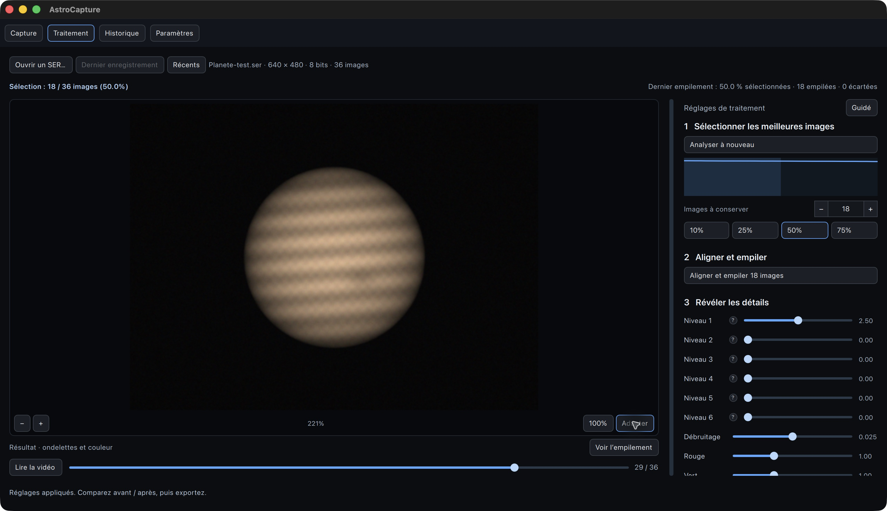
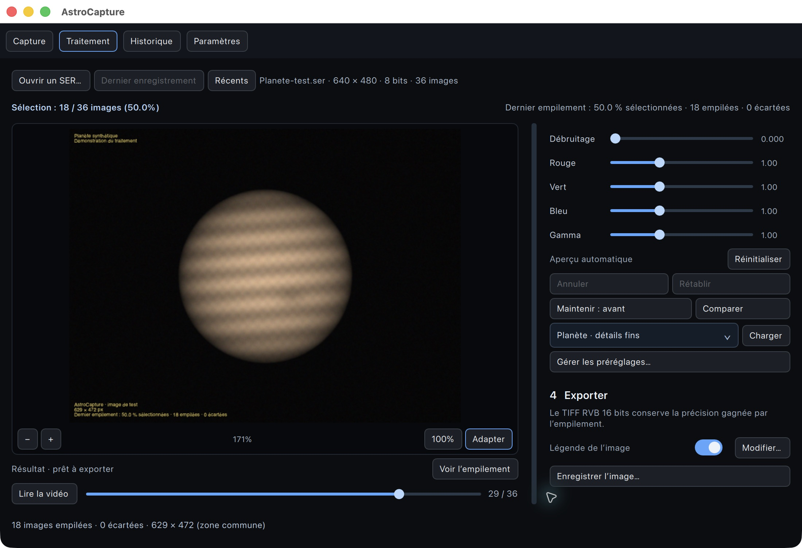
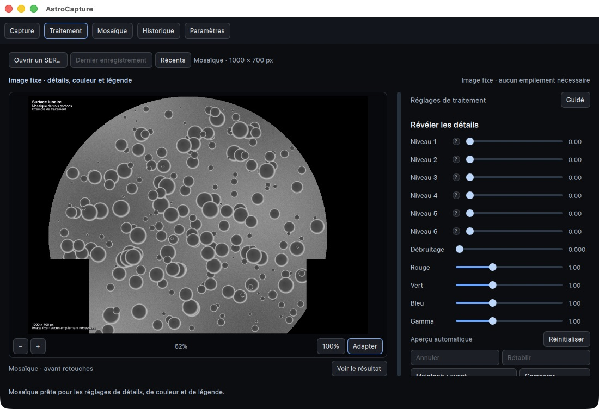

  

# AstroCapture

**De la caméra à l’image finale, dans une seule application sur Mac.**

AstroCapture réunit la capture vidéo et FITS, le traitement planétaire, la calibration et l’empilement du ciel profond, les transformations de finition, les ondelettes et les mosaïques. Son studio conserve les espaces de travail entre les onglets, avec une interface en français et en anglais. Les fichiers et les traitements restent sur votre ordinateur.

## Installer sur macOS

Ouvrez `AstroCapture-<version>.dmg`, glissez **AstroCapture** dans **Applications**, puis lancez l’application. Pour une mise à jour, quittez d’abord AstroCapture et remplacez l’application existante. Les préférences, les préréglages et l’historique sont conservés séparément de l’application.

Le paquet actuel est destiné aux Mac Apple Silicon. Il n’est pas encore signé avec un certificat Apple Developer ID ni notarisé : macOS peut demander une autorisation d’ouverture.

Aucune caméra n’est nécessaire pour traiter un SER existant. Une caméra simulée permet également d’essayer l’acquisition.

## Capture

L’onglet **Capture** affiche le flux de la caméra et les commandes disponibles pour le matériel connecté : exposition, gain, résolution et zone de capture lorsqu’elle est prise en charge. L’aperçu couleur interprète la matrice de Bayer des capteurs compatibles.

L’histogramme permet de surveiller l’exposition. La cadence, les compteurs d’images et les pertes signalées aident à contrôler la capture. Les images fixes peuvent être enregistrées en PNG, TIFF 16 bits ou FITS brut ; le format SER est recommandé pour les vidéos destinées à l’empilement.

La **Celestron NexImage 5** est le matériel de référence : capteur MT9P031, 2 592 × 1 944 pixels de 2,2 µm. La réception des images a été vérifiée sur Mac. Le profil Bayer GBRG actuellement utilisé reste à confirmer avec une cible de couleur connue. Les possibilités de réglage dépendent du pilote et de la caméra ; la compatibilité de chaque autre modèle doit être vérifiée individuellement.

## Accélération Apple Silicon

Depuis la version 1.0.1, AstroCapture utilise automatiquement **Metal** pour les réglages de ciel
profond à partir de 1 MP et pour les ondelettes actives à partir de 0,26 MP.
L’étirement classique ou asinh, les gains couleur, la saturation, le lissage et
les six échelles d’ondelettes conservent des pixels **RGB flottants 32 bits**.
L’aperçu 8 bits est calculé dans la même commande GPU, puis affiché à sa
résolution complète. Une conversion d’aperçu seule reste sur CPU : les mesures
montrent que sa copie vers le GPU coûterait plus que son calcul.

Sur un **M1 Pro**, avec le résultat Siril M8/M20 de **6244 × 4172** pixels,
les mesures incluent les allocations et copies des traitements ; elles ne sont
pas une promesse sur le temps total d’importation ou d’empilement. Les résultats
et la méthode de mesure sont consignés dans les notes locales `docs/`.

Les calculs GPU travaillent par bandes avec recouvrement pour préserver les
bords et raccords tout en limitant la mémoire temporaire. L’annulation attend
la fin du bloc GPU en cours avant de libérer ses données. Le CPU prend le relais
si Metal est absent, désactivé, manque de mémoire ou rencontre une erreur.
Les petites images gardent le CPU. La calibration, la détection et l’alignement
d’étoiles, l’empilement et les exports conservent leurs méthodes actuelles.

Pour compiler sans cette accélération : `-DASTRO_ENABLE_METAL=OFF`. Pour un
contrôle ponctuel sur Mac : lancez l’application avec `ASTRO_DISABLE_METAL=1`.
Les autres systèmes utilisent le moteur CPU, sans dépendance Metal.

## Ciel profond

L’onglet **Ciel profond** propose un parcours inspiré de l’organisation
d’Astro Pixel Processor, avec les principes de calibration et de traitement
linéaire décrits dans le [tutoriel de Siril](https://siril.org/fr/tutorials/tuto-scripts/) : charger, calibrer, analyser les étoiles, aligner,
normaliser, empiler puis finir l’image. Réglez les étapes puis lancez toute la
chaîne avec **Créer l’image empilée**. Les panneaux **Images**, **Réglages
d’empilement** et **Finition et export** organisent les réglages : aucune étape
numérotée à exécuter séparément. Le mode brut est sélectionné par défaut ;
cochez **Poses déjà calibrées** uniquement pour des données déjà prétraitées.

- Utilisez **Ajouter des fichiers…** ou **Importer un dossier…**. Le mode de
  détection automatique classe les images selon leurs métadonnées et noms ;
  vérifiez et corrigez les types et groupes directement dans la liste. Les
  fichiers de résultat nommés resultat, stack, rvb ou hoo sont écartés de
  l’importation automatique d’un dossier.
- Importez les **FITS individuels** d’iTelescope, y compris les FITS compressés,
  ou des **RAW à matrice Bayer**. Les PNG/TIFF sont aussi acceptés. Pour des
  FITS déjà calibrés, cochez **Poses déjà calibrées**.
- Le groupe **Auto** lit le filtre de l’en-tête FITS ; choisissez R, G, B, L,
  HA, OIII ou SII si nécessaire. Les filtres sont empilés séparément.
- Pour les poses brutes, ajoutez darks, flats, bias et éventuellement darks de
  flats. Un dark brut contient déjà le bias : il n’est pas soustrait deux fois.
  Les darks doivent correspondre à la durée d’exposition et aux paramètres
  connus du capteur. Les flats sont associés à leur groupe de filtres.
- La correction des pixels défectueux utilise une carte importée ou détecte
  les pixels chauds isolés du master dark. Elle respecte la matrice de Bayer
  avant dématriçage.
- Inspectez le nombre d’étoiles, la FWHM en pixels et les aperçus ; décochez les
  poses à exclure. **Référence** choisit la référence d’un groupe.
- L’alignement sur les étoiles corrige déplacements, rotations et petits
  écarts d’échelle. Au moins six étoiles identifiables sont nécessaires pour
  recaler une autre pose. La normalisation globale harmonise le flux des
  étoiles et les offsets du fond de ciel ; elle peut être désactivée.
- L’intégration utilise une moyenne avec ou sans rejet robuste par médiane/MAD.
  Le rejet nécessite trois poses retenues ou plus. Le résultat est recadré sur
  la couverture commune. Le bilan indique les poses exclues et les valeurs
  rejetées ; les images alignées utilisent de l’espace disque temporaire.
- Composez les couches en **RGB, LRGB, SHO ou HOO**, puis réglez le fond de
  ciel, les gains couleur, les niveaux noir/blanc, les tons moyens ou l’étirement
  asinh (maximum, luminance visuelle ou moyenne RGB), la saturation avec protection du fond sombre et le lissage
  du bruit. L’histogramme RGB/luminance représente l’image affichée. Un second
  histogramme montre l’entrée du brouillon, après la recette et la correction
  de gradient, avec les gains couleur courants et
  la courbe d’étirement : choisissez Noir, Tons moyens ou Blanc et glissez
  dans le graphique. Le zoom du graphique ne modifie pas les données. Les
  taux de coupure sont estimés par échantillonnage.
- Les aperçus de sources distinguent matrice **Bayer**, image **RGB** et image
  **monochrome**. **Aperçu couleur** et **Étirement d’affichage automatique**
  sont indépendants des données utilisées pour la calibration.
- L’extraction du gradient ajuste chaque couche séparément : polynôme d’ordre
  1 à 4, grille de 2 à 50 échantillons par ligne (20 par défaut), tolérance de
  rejet en unités MAD (1 par défaut). Les échantillons se modifient sur l’image :
  clic gauche pour ajouter, clic droit pour retirer. Le modèle du fond peut
  être affiché séparément pour contrôler la correction. Les modèles insuffisamment
  contraints sont refusés. Une correction d’ordre 1 peut aussi s’appliquer à
  chaque pose calibrée et dématricée avant alignement ; elle reste facultative.
- La finition propose rotations de 90°, 180°, 270° et miroirs horizontal/vertical.
  Les exports finaux les utilisent ; le FITS linéaire garde l’intégration source.
- La suppression du vert (SCNR) offre quatre protections et la préservation CIE
  de luminosité. Elle agit sur des valeurs RGB étirées dans [0, 1]. Les méthodes
  par masque proposent un dosage ; les méthodes neutres n’utilisent pas ce dosage.
  Préservez les couleurs vertes intentionnelles des comètes, nébuleuses ou palettes SHO.
- L’aperçu des réglages en direct peut être désactivé. Les demandes successives
  de finition sont regroupées : la dernière position des curseurs est conservée.
  Choisissez une pose dans la liste de comparaison et maintenez **Pose brute**
  pour afficher cette source face au résultat courant. Son étirement automatique
  et son cadrage sont indépendants ; cette vue n’est pas un recalage pixel à pixel.
  La comparaison ne change pas l’export. Revenez au linéaire ou utilisez la proposition
  automatique. Les valeurs numériques restent éditables ; les calculs repartent
  de l’intégration linéaire et rejouent les transformations appliquées dans leur ordre.
  **Appliquer le brouillon comme transformation** valide les réglages courants,
  puis remet les commandes à zéro. Cela permet notamment plusieurs étirements
  successifs. Chaque transformation peut être modifiée, désactivée, remontée ou
  supprimée ; les suivantes sont recalculées. Le projet et les préréglages
  conservent cette recette, les deux versions A/B et leurs réglages. Un cache
  borné évite de rejouer une recette inchangée pendant les ajustements suivants.
- Exportez le **FITS linéaire 32 bits** pour préserver l’intégration, ou le
  **TIFF 16 bits final** avec profil sRGB. Un JPEG sRGB peut aussi être exporté.
  **Image finale…** propose ces deux formats. **Détails et légende…** transmet
  le résultat final à Traitement, avec le nombre de poses, leur durée totale et
  les filtres pour la légende technique.
- Le **rouage** regroupe ouvrir, enregistrer et vider le projet. Les
  paramètres avancés se déplient et les boutons **?** expliquent les réglages.
- Les projets **.astroproject** conservent les références des fichiers,
  leurs rôles, groupes, sélections, références et les options. Les fichiers
  sources doivent rester accessibles ; les intégrations sont recalculées.

Les données originales restent linéaires et ne sont jamais écrasées. Le premier
aperçu et la première finition utilisent un étirement adaptatif et des gains
couleur estimés sur le fond de ciel, sans calibration photométrique ; les exports
linéaires ne l’appliquent pas. Les réglages repartent toujours de l’intégration
linéaire, sans accumuler les traitements précédents.

**Échelle des données :** les FITS entiers sont normalisés selon leur plage.
Pour les FITS flottants sans indication spécifique, des valeurs supérieures à
2 sont interprétées comme des ADU sur une échelle de 65535 ; sinon l’échelle est
1. Le champ **Échelle ADU** permet d’imposer une autre convention à l’import.
Utilisez une échelle cohérente entre poses et calibrations. La correction
automatique du gradient est un ajustement planaire : comparez avec l’option
désactivée sur des nébulosités étendues.

Limites actuelles : **32 MP par image**, **500 poses sélectionnées par groupe**,
**2000 fichiers par projet**. Les RAW X-Trans et les autres matrices non Bayer
ne sont pas pris en charge. Le drizzle, la correction optique dynamique, les
projections grand angle, la fusion HDR et la calibration photométrique des
couleurs restent à développer. La précision de centroidage annoncée par APP
n’est pas une mesure de performance d’AstroCapture.

### Acquisition de séries FITS

Dans Capture, choisissez **Ciel profond · Série FITS**, la durée de pose, le
nombre d’images, le type de calibration et le filtre. Chaque image conserve les
pixels du capteur avant dématriçage et les métadonnées disponibles. Les réglages
de la caméra sont verrouillés pendant l’enregistrement. Une image commencée
avant le lancement de la série est écartée au démarrage.

Les photos fixes FITS conservent également les pixels bruts ; les photos TIFF
sont dématricées avec leur précision réelle, sans passer par l’aperçu 8 bits.
Le suivi et l’autoguidage de la monture restent externes. Les poses longues
dépendent des capacités du pilote et doivent être validées sur le matériel réel.

## Traitement

Déposez un fichier **SER ou ACRAW** dans la fenêtre, ouvrez-le avec le sélecteur de fichiers ou retrouvez-le dans **Récents**. Les dix dernières vidéos ouvertes avec succès sont mémorisées.

Pour retoucher une image existante, utilisez **Ouvrir…** ou déposez un **PNG ou TIFF** dans l’onglet Traitement. Les ondelettes, la couleur, la comparaison avant / après et la légende sont disponibles directement, sans analyse ni empilement. Les images 8 et 16 bits sont acceptées, jusqu’à **32 MP**, avec conservation des valeurs 16 bits. Les fichiers multipages ne sont pas acceptés et la transparence est placée sur fond noir. L’export crée un TIFF distinct ; l’original est protégé contre l’écrasement.

### 1. Sélectionner les images

**Analyser la vidéo** attribue un score de netteté à chaque image et les classe de la plus nette à la plus floue. La courbe représente ce classement, et non l’ordre chronologique de la vidéo. Sa hauteur indique la netteté relative, avec la meilleure image à 100 % ; la zone colorée correspond à la sélection.

Choisissez un nombre d’images, un pourcentage, ou déplacez la limite bleue directement sur le graphique. La sélection part toujours des meilleures images. Une sélection de 25 à 50 % constitue un point de départ : conserver moins d’images privilégie les meilleures prises, tandis qu’en conserver davantage peut réduire le bruit. Le score reste une aide à la décision, sensible au bruit et aux conditions de prise de vue. Le nombre et le pourcentage retenus restent visibles au-dessus de l’aperçu.

### 2. Aligner et empiler

**Aligner et empiler** recale les images sélectionnées par translation, avec un affinement inférieur au pixel, puis en calcule la moyenne. Les alignements incertains sont écartés et l’image finale est recadrée sur la zone commune. Le bilan indique combien d’images ont effectivement été empilées.

Pour la **Lune et le Soleil**, choisissez le mode correspondant avant d’empiler. Après le recalage global, des zones de la surface sont suivies séparément pour atténuer les déformations dues à la turbulence. Les zones peu fiables conservent le recalage global. Commencez avec des zones de **96 pixels** ; essayez 64 pixels sur des détails fins et contrastés, ou 160 pixels sur une surface plus douce ou bruitée. L’option **Meilleures images par zone**, activée par défaut dans ce mode, choisit des prises différentes pour chaque portion de la surface. Une image dont seule une partie est nette peut ainsi contribuer utilement. La limite bleue fixe alors un maximum d’images **par zone**, et non une liste identique pour toute l’image. La courbe reste le classement global ; le bilan distingue la sélection par zone du nombre total de prises utilisées. Cette sélection parcourt toute la vidéo et prend davantage de temps. Désactivez-la pour conserver la sélection globale avec correction locale.

Filmez avec des poses courtes, une mise au point soignée et une exposition qui préserve les hautes lumières. La sélection rejette les prises les plus floues ; l’alignement local réduit les déplacements des détails ; la moyenne atténue le bruit. Aucun traitement ne peut restituer les détails absents de toutes les images. Pour le Soleil, utilisez impérativement un équipement de filtration solaire adapté à votre instrument.

Le résultat est une **image fixe**. **Lire la vidéo** et le curseur temporel affichent toujours les images du SER d’origine ; le bouton de résultat permet de revenir à l’empilement. Les opérations longues affichent leur progression et peuvent être annulées.

### 3. Révéler les détails

Les six niveaux d’ondelettes agissent sur des échelles de détail qui doublent progressivement de taille :

| Niveaux | Effet principal |
| --- | --- |
| 1–2 | Détails fins et petits contours ; ils renforcent aussi facilement le bruit. |
| 3–4 | Structures intermédiaires et transitions. |
| 5–6 | Grandes structures et variations de contraste ; des gains élevés peuvent créer des halos. |

Ces échelles se recouvrent : un niveau ne correspond pas à un objet astronomique précis. Les gains vont de **0 à 50 pour le niveau 1**, de **0 à 20 pour les niveaux 2 et 3**, et de **0 à 10 pour les niveaux 4 à 6**. Un gain nul n’ajoute aucun détail à cette échelle ; augmenter le gain renforce aussi le bruit et peut créer des halos. Les valeurs ne sont pas interchangeables avec celles d’autres logiciels. Le débruitage atténue les petites variations des détails ajoutés ; les gains rouge, vert et bleu et le gamma permettent d’ajuster la couleur et la luminosité.

L’aperçu se met à jour après une courte pause pendant les réglages. **Annuler / Rétablir** permet de parcourir jusqu’à 100 modifications des paramètres, chaque glissement comptant comme une modification. Les préréglages nommés enregistrent les ondelettes, le débruitage, les gains couleur et le gamma pour les réutiliser sur une autre vidéo.

Maintenez **Avant** pour revoir l’empilement sans les réglages de finition, ou activez **Comparer** : la séparation déplaçable montre l’avant à gauche et l’après à droite. Le zoom, le déplacement de l’image et la comparaison n’affectent pas le fichier exporté.

### 4. Exporter

Le résultat est enregistré en **TIFF RGB 16 bits par canal**, en conservant la précision issue de l’empilement et des réglages. Le SER d’origine reste inchangé. Le dossier utilisé pour le dernier export réussi est mémorisé.

Une **légende facultative** peut être inscrite dans le TIFF : objet, date d’observation, notes en haut à gauche ; observateur et matériel en bas à gauche. Un champ **Titre** place un titre plus grand juste au-dessus du texte de la légende. Le texte, sa taille et sa couleur (blanc ou doré) sont réglables. Les dimensions et le bilan d’empilement peuvent être ajoutés automatiquement. L’aperçu montre le résultat avant export ; désactiver la légende permet d’exporter l’image sans texte, toujours en 16 bits. Les dates et coordonnées astronomiques sont à renseigner manuellement. La légende est effacée à l’ouverture d’une autre vidéo pour éviter de réutiliser les informations d’une autre observation.

| Usage | Formats |
| --- | --- |
| Vidéo à traiter | ACRAW ou SER monochrome, Bayer, RGB ou BGR, de 1 à 16 bits par canal. |
| Image à retoucher directement | PNG ou TIFF, 8 ou 16 bits, une seule image, jusqu’à 32 MP. |
| Images issues de la caméra | PNG, TIFF 16 bits, FITS brut ; séries de FITS individuels. |
| Ciel profond | FITS (entiers, flottants, compressés), RAW Bayer, PNG, TIFF. |
| Résultat du traitement | TIFF RGB 16 bits par canal. |
| Images à assembler en mosaïque ou à ajouter à l’historique | TIFF, PNG, JPEG. |

En capture, enregistrer une source 8 bits dans un TIFF 16 bits conserve ses valeurs sans créer de nouvelles informations. En traitement, l’empilement calcule des valeurs intermédiaires que l’export 16 bits permet de préserver.

## Mosaïque

Déposez plusieurs **TIFF, PNG ou JPEG** dans **Mosaïque**, puis cliquez sur **Assembler automatiquement**. L’application recherche les détails communs, ajuste la position, la rotation et les petits écarts d’échelle, puis fond les recouvrements. L’option **Harmoniser la luminosité** compense les différences globales d’exposition entre les vues. Les images apparaissent dans une **grille de vignettes** : cochez les vues à utiliser et décochez celles à laisser de côté. Le compteur distingue les images sélectionnées du total chargé. Le sélecteur de fichiers utilise le panneau natif de macOS, filtré sur TIFF, PNG et JPEG. Seules les vignettes visibles se chargent, en arrière-plan. Le résultat peut être examiné au zoom, accompagné d’une **légende avec titre**, exporté en TIFF 16 bits et ajouté à l’historique.

**Retoucher dans Traitement…** transfère la mosaïque pour ajuster les ondelettes, le débruitage, les couleurs et le gamma, sans l’empiler de nouveau. La précision de l’image est conservée et la légende reste modifiable. Pour un résultat homogène, empilez d’abord chaque portion, assemblez-les, puis appliquez une finition légère à l’ensemble et ajoutez la légende. Le transfert remplace l’image actuellement ouverte dans Traitement ; exportez un résultat à conserver avant de le remplacer.

Pour reconstituer la Lune ou le Soleil, prévoyez **25 à 40 % de recouvrement**, avec le même matériel, la même séance et des réglages aussi constants que possible. Des portions déjà empilées donnent généralement une base plus propre. Assemblez les images avant d’y inscrire une légende. La surface doit présenter des détails reconnaissables : une zone solaire uniforme ou un champ presque entièrement noir peut empêcher le raccordement.

Une mosaïque accepte de **2 à 100 images**, jusqu’à **24 MP par image** et **32 MP pour le résultat**. Dans **Options d’assemblage**, l’exclusion automatique conserve le plus grand groupe de vues raccordables. Les autres restent visibles dans la grille, décochées ; le bilan les signale et permet de les réintégrer. Il faut au moins deux vues compatibles : si aucune paire ne se raccorde, l’application explique l’échec et conserve la sélection pour réessayer. Désactivez cette option pour exiger que toutes les vues sélectionnées soient raccordées. Les zones non photographiées restent noires. Les originaux ne sont ni déplacés ni modifiés.

L’option **Adoucir les bords de la mosaïque**, activée par défaut, écarte deux pixels sur le bord de chaque vue et fond progressivement la limite de couverture vers le noir. Une fine bande est donc assombrie. Cette limite reste protégée des ondelettes lors du transfert vers Traitement. Cela réduit les liserés artificiels sans reconstituer les zones manquantes ni corriger tous les défauts de raccordement internes.

Pour le Soleil, le noir et blanc convient. Les surfaces uniformes et les arcs du limbe seuls donnent moins de repères distinctifs que les cratères lunaires ; les taches et les détails de surface partagés facilitent le raccordement. La recherche de repères réduit le bruit et renforce le contraste sur une copie de travail ; les pixels exportés conservent la précision des originaux.

L’assemblage ne corrige pas la rotation solaire, l’évolution des protubérances ni les déformations locales entre photographies. Des vues prises trop loin dans le temps ou sous une turbulence forte peuvent produire des raccords imparfaits. Ce mode n’invente pas les parties manquantes.

## Historique

L’historique rassemble jusqu’à **500 chemins d’images**. Les exports peuvent y être ajoutés automatiquement ; les images déjà traitées s’ajoutent par glisser-déposer ou avec **Ajouter des images**.

Sélectionnez une image pour l’examiner, zoomez jusqu’à 100 % ou davantage, puis ouvrez-la dans votre lecteur d’images ou affichez son emplacement dans le Finder. **Retirer** enlève uniquement l’entrée de l’historique : le fichier reste sur le disque.

Les chemins devenus introuvables sont retirés automatiquement au démarrage, à l’ouverture de l’onglet et régulièrement lorsqu’il est actif. Cela concerne aussi les fichiers sur un disque déconnecté : ils peuvent être ajoutés de nouveau après reconnexion. L’historique référence les fichiers à leur emplacement d’origine, sans en conserver de copie.

## Guide intégré

L’onglet **Guide**, disponible hors connexion en français et en anglais, explique les étapes d’une prise de vue, les formats de fichiers, la courbe de qualité, les ondelettes, le recalage local, la préparation d’une mosaïque et le fonctionnement des exports et de l’historique. Chaque sujet propose un accès à l’onglet correspondant.

## Paramètres

Les paramètres globaux centralisent :

- **La langue** : français ou anglais, avec changement immédiat.
- **La présentation du traitement** : mode guidé avec explications ou compact. La largeur du panneau se règle en déplaçant sa séparation et reste mémorisée.
- **Le dossier de capture** : images de la caméra et vidéos, réparties dans les sous-dossiers `Images` et `Videos` d’un dossier personnalisé.
- **Le dossier d’export du traitement** : TIFF produits après empilement et finition, ainsi que les mosaïques.
- **L’ajout automatique à l’historique**, activable indépendamment de l’ajout manuel.

Les commandes propres à la caméra restent dans **Capture**. Les préférences et les préréglages persistent après un redémarrage ou une mise à jour ; le traitement en cours et sa pile d’annulation ne constituent pas une session sauvegardée.

## Navigation

| Action sur Mac | Geste ou raccourci |
| --- | --- |
| Ouvrir un SER, PNG ou TIFF | ⌘ O ; déposer les images directement dans Traitement. |
| Capture / Traitement / Historique / Paramètres | ⌘ 1 / ⌘ 2 / ⌘ 3 / ⌘ 4. |
| Mosaïque | ⌘ 5. |
| Guide | ⌘ 6. |
| Lire ou mettre en pause la vidéo | Espace, dans Traitement. |
| Image précédente / suivante | ← / →, hors lecture. |
| Annuler / rétablir un réglage | ⌘ Z / ⌘ ⇧ Z. |
| Zoomer dans Traitement, Mosaïque ou Historique | Molette, pincement au pavé tactile ou boutons − / +. |
| Déplacer l’image agrandie | Glisser dans l’image. |
| Passer entre cadrage adapté et 100 % | Double-clic dans l’image. |

À 100 %, un pixel de l’image correspond à un pixel physique de l’écran, y compris sur un écran Retina. Les raccourcis de navigation sont suspendus pendant la saisie de texte.

## Périmètre actuel

AstroCapture propose un alignement global par translation et une correction locale des surfaces lunaires et solaires. Le mode Lune / Soleil peut sélectionner les meilleures prises indépendamment pour chaque zone. La qualité dépend du contraste, du bruit, du recouvrement entre prises et de l’intensité de la turbulence ; les zones sans détail fiable ne bénéficient pas d’un recalage local. La dérotation planétaire n’est pas disponible. Le ciel profond utilise son propre onglet avec les limites décrites plus haut. L’import AVI et la restauration complète d’une session de traitement ne sont pas disponibles.

Les captures d’écran présentent l’application réelle, avec une caméra simulée et des images synthétiques pour illustrer les commandes. Elles ne constituent pas une mesure de performance sur une observation astronomique.

## Développement

La compilation utilise Qt 6, OpenCV, CFITSIO et LibRaw. Sur Mac, installez les
dépendances astronomiques avec `brew install cfitsio libraw`, puis utilisez les
préréglages CMake indiqués dans CONTRIBUTING.md. Les bibliothèques requises et
leurs notices sont intégrées au paquet macOS ; elles ne doivent pas être
installées séparément pour utiliser le DMG.

Le numéro de version est visible dans le titre de la fenêtre et les paramètres.
Le bouton **Signaler un bug** prépare un e-mail vers antoninlefevre45@gmail.com
avec la version et les étapes de reproduction, à relire avant envoi.

Dans **Ciel profond → Finition et export**, les préréglages conservent les réglages
de finition (niveaux absolus inclus), sans calibration ni composition des canaux.
Chaque version A/B possède ses réglages et son historique de 100 modifications.
Un déplacement de curseur compte comme une action ; Annuler/Rétablir et leurs
raccourcis habituels permettent de revenir sur les essais. Copier A vers B (ou
l’inverse) duplique la finition. Le nouvel empilement ou la nouvelle composition
réinitialise A/B. Les projets sauvegardent les deux versions et la version active,
mais pas les historiques d’annulation. Sans aperçu automatique, appliquer les
réglages en attente est nécessaire avant l’export final ou le transfert.

### Interface Studio (1.2.0)

L’application démarre sur **Accueil**, avec les accès Capture, Traitement et Ciel
profond, les projets de ciel profond récemment ouverts ou enregistrés et les
vidéos SER récentes. **Reprendre** revient au travail en mémoire. **Ouvrir** recharge
un projet enregistré ; recréez son empilement pour retrouver sa finition.
Les fichiers manquants sont signalés et les originaux restent dans leurs dossiers.

Les onglets restent visibles et conservent images, cadrage et réglages. Les
calculs continuent lors d’un changement d’onglet ; leur activité est indiquée en
haut et en bas. En Ciel profond, l’inspecteur de droite regroupe Images, Empilement
et Finition, avec l’histogramme linéaire interactif. La liste des fichiers se replie en
finition ; **Fichiers sources** permet de la retrouver. Le rouage supérieur ouvre les
réglages de l’application, celui du projet gère ses fichiers.

Raccourcis : Ctrl+1 Accueil, Ctrl+2 Capture, Ctrl+3 Traitement, Ctrl+4 Ciel profond,
Ctrl+5 Mosaïque, Ctrl+6 Historique, Ctrl+7 Guide, Ctrl+8 Réglages. Pendant une
capture, les onglets Accueil, Capture et Guide restent disponibles.
